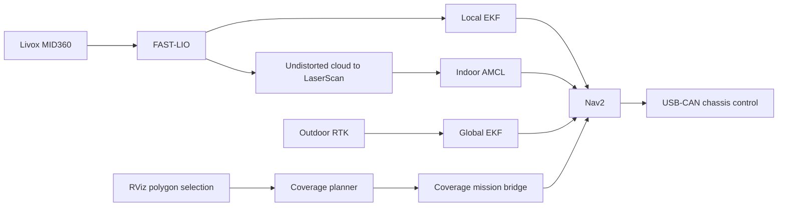

# Quantum Base Plate Navigation

[简体中文](README.md) | **English**

A **ROS 2 Humble** workspace for Ackermann robot navigation, integrating Livox MID360, FAST-LIO, Nav2, and coverage path planning. It provides separate entry points for indoor AMCL navigation, outdoor RTK navigation, and standalone coverage previews.

Repository: [`wyz030210/quatum_base_plate_nav`](https://github.com/wyz030210/quatum_base_plate_nav)

## Features

| Feature | Implementation | Entry point |
| --- | --- | --- |
| Indoor navigation | MID360 + FAST-LIO + local EKF + AMCL + Nav2 | `robot_bringup indoor_amcl.launch.py` |
| Outdoor navigation | MID360 + FAST-LIO + RTK + local/global EKFs + Nav2 | `robot_bringup outdoor_ekf.launch.py` |
| Coverage preview | RViz polygon selection, swath generation, and turning path visualization | `wheeltec_nav2 coverage_preview.launch.py` |
| Coverage execution | Coverage planning, approach to the start point, and Nav2 path tracking | Add `use_coverage:=true` to a vehicle launch command |
| Chassis control | USB-CAN communication, velocity-to-steering conversion, and feedback queries | `vehicle_can_bridge` |

Select indoor or outdoor operation through its launch entry point. Coverage previews run on a development computer without a chassis or sensors.

## Architecture



AMCL and the global EKF belong to the indoor and outdoor modes respectively. TF ownership is:

| Transform | Indoor | Outdoor |
| --- | --- | --- |
| `map → odom` | AMCL | Global EKF |
| `odom → base_link` | Local EKF | Local EKF |

FAST-LIO publishes `/Odometry`. Its odometry TF output is disabled in the vehicle configurations so the local EKF owns `odom → base_link`.

## Requirements

- Ubuntu 22.04, ROS 2 Humble, `colcon`, and `rosdep`.
- ROS dependencies include Nav2, `robot_localization`, `pointcloud_to_laserscan`, and RViz2.
- Native libraries include Livox-SDK2, Eigen, PCL, and GeographicLib. Coverage planning also requires Fields2Cover.
- Vehicle hardware: a Livox MID360, an Ackermann chassis compatible with the implemented CAN protocol, and an RTK receiver for outdoor operation.

**Coverage planning sources are included:** `src/opennav_coverage/` is tracked as regular source files in this repository, including `opennav_coverage`, `opennav_coverage_msgs`, and local adaptations. Cloning this project provides these sources. The upstream project is [OpenNav Coverage](https://github.com/open-navigation/opennav_coverage); see [LOCAL_CHANGES.md](src/opennav_coverage/LOCAL_CHANGES.md) for provenance and local modifications.

**Install Fields2Cover separately:** `.gitignore` still excludes `src/Fields2Cover/`, so cloning this repository does not provide that library. Obtain its sources from the [Fields2Cover upstream repository](https://github.com/Fields2Cover/Fields2Cover). The current [coverage dependency manifest](src/opennav_coverage/.github/deps.repos) specifies `v2.0.0`.

See the [Livox driver documentation](src/livox_ros_driver2/README.md) for Livox-SDK2 installation instructions.

## Clone and build

Follow these steps in order in a Bash environment with ROS 2 Humble, `git`, `colcon`, and `rosdep` installed.

### 1. Download the source

From the directory where you want to keep the project, clone the repository into `new_base_plate_indoor_ws`:

```bash
git clone https://github.com/wyz030210/quatum_base_plate_nav.git new_base_plate_indoor_ws
```

This also retrieves the OpenNav Coverage sources and local adaptations maintained by this project. A separate upstream clone or submodule initialization is not required.

### 2. Enter the workspace root

```bash
cd new_base_plate_indoor_ws
```

Run the following dependency installation, build, and environment commands from this directory. The source packages are under `src/`.

### 3. Load the ROS 2 Humble environment

```bash
source /opt/ros/humble/setup.bash
printenv ROS_DISTRO
```

The second command should print `humble`. If the setup script does not exist, complete the ROS 2 Humble installation first.

### 4. Prepare external native dependencies

Prepare Livox-SDK2 and the other native libraries listed under Requirements, and install a compatible Fields2Cover library. Refer to `v2.0.0` in the [coverage dependency manifest](src/opennav_coverage/.github/deps.repos) for the version.

OpenNav Coverage and its message package are already included under `src/opennav_coverage/`. `colcon` builds them with the workspace dependencies in the later build step. Complete external dependency preparation before continuing; `rosdep` does not fetch the ignored Fields2Cover sources.

### 5. Initialize and update rosdep

On first use of `rosdep` on this computer, initialize its system-wide dependency sources:

```bash
sudo rosdep init
```

Skip that command if initialization was already completed. Then update the dependency index as your regular user:

```bash
rosdep update
```

### 6. Install dependencies declared by the source packages

```bash
rosdep install --from-paths src --ignore-src --rosdistro humble -r -y
```

This scans the `package.xml` files under `src/` and installs system dependencies it can resolve. `--ignore-src` skips packages already present as workspace sources, `--rosdistro humble` selects the ROS distribution, and `-y` confirms installation automatically.

`-r` continues attempting other dependencies after errors, so check the output when it finishes. Resolve any reported dependency resolution or installation failures before building.

### 7. Build the vehicle bringup package and its dependencies

```bash
colcon build --symlink-install --packages-up-to robot_bringup \
  --cmake-args -DROS_EDITION=ROS2 -DHUMBLE_ROS=humble
```

- `--symlink-install`: installs files using symbolic links where possible to support development.
- `--packages-up-to robot_bringup`: builds `robot_bringup` and its recursive dependencies.
- `-DROS_EDITION=ROS2 -DHUMBLE_ROS=humble`: passes the ROS 2 / Humble build options used by the current Livox driver to CMake.

Wait for the build to finish and check that the summary contains no failed or aborted packages before loading the environment.

### 8. Load the workspace and check package discovery

```bash
source install/setup.bash
ros2 pkg prefix robot_bringup
```

The last command should print the installation path of `robot_bringup` inside this workspace. Continue with Quick start to choose a preview or vehicle launch mode.

In every new runtime terminal, enter the workspace root and run:

```bash
source /opt/ros/humble/setup.bash
source install/setup.bash
```

## Quick start

Run the following commands from the root of a built workspace.

### 1. Preview coverage on a computer

```bash
source /opt/ros/humble/setup.bash
source install/setup.bash
export ROS_DOMAIN_ID=94
export ROS_LOCALHOST_ONLY=1

ros2 launch wheeltec_nav2 coverage_preview.launch.py
```

In RViz, select **Publish Point**, click at least three vertices around the region, then click near the first vertex to close the polygon. A successful plan displays the boundary, coverage path, and working swaths.

This entry point computes and displays paths without starting chassis control or navigation execution. The domain and localhost settings in this terminal are for standalone preview. Use another terminal with the robot's communication settings for vehicle navigation.

### 2. Indoor AMCL navigation

Check the LiDAR network, chassis serial port, and map first. Replace the map and device paths with values for your system.

```bash
source /opt/ros/humble/setup.bash
source install/setup.bash

ros2 launch robot_bringup indoor_amcl.launch.py \
  map:=/absolute/path/to/indoor_map.yaml \
  can_serial_port:=/dev/serial/by-id/YOUR_CAN_DEVICE \
  use_rviz:=true
```

The map argument must be an absolute path to an existing YAML file. Its referenced image must also be readable. Maps are included under `src/wheeltec_nav2/map/`; confirm that a map matches your environment before using it.

After startup, set the initial pose with **2D Pose Estimate** in RViz. Check that the scan aligns with the map, then send a goal using **Nav2 Goal**. For a headless robot computer, set `use_rviz:=false` and connect RViz from a computer with matching communication settings.

### 3. Outdoor RTK navigation

```bash
ros2 launch robot_bringup outdoor_ekf.launch.py \
  map:=/absolute/path/to/outdoor_map.yaml \
  can_serial_port:=/dev/serial/by-id/YOUR_CAN_DEVICE \
  rtk_serial_port:=/dev/serial/by-id/YOUR_RTK_DEVICE \
  datum_lat:=YOUR_DATUM_LATITUDE \
  datum_lon:=YOUR_DATUM_LONGITUDE
```

Replace all `YOUR_...` placeholders before running. Register the outdoor map to the RTK datum and ENU axes, and use separate device paths for CAN and RTK. The outdoor entry point uses the global EKF for `map → odom` and does not launch AMCL.

### 4. Enable coverage missions

Append this argument to either vehicle launch command:

```text
use_coverage:=true
```

This loads the coverage nodes. The execution action is `/execute_coverage_navpath`. When a mission is submitted, the bridge computes the coverage path, guides the vehicle to the start point, and passes the path to Nav2 for tracking. See the documentation below for preview and vehicle mission operation.

## Configuration

| Configuration | Path |
| --- | --- |
| MID360 network and device IP | [`MID360_config.json`](src/livox_ros_driver2/config/MID360_config.json) |
| Indoor FAST-LIO | [`mid360_indoor.yaml`](src/fast_lio/src/FAST_LIO/config/mid360_indoor.yaml) |
| Local / global EKF | [`ekf_odom.yaml`](src/wheeltec_nav2/param/wheeltec_params/ekf_odom.yaml) / [`ekf_map.yaml`](src/wheeltec_nav2/param/wheeltec_params/ekf_map.yaml) |
| Indoor Nav2 | [`param_mini_diff_indoor.yaml`](src/wheeltec_nav2/param/wheeltec_params/param_mini_diff_indoor.yaml) |
| Outdoor Nav2 | [`param_mini_diff.yaml`](src/wheeltec_nav2/param/wheeltec_params/param_mini_diff.yaml) |
| Coverage planning | [`coverage_params.yaml`](src/wheeltec_nav2/param/coverage_params.yaml) |
| Example coverage task | [`coverage_navpath_task.yaml`](src/nav2_mission/config/coverage_navpath_task.yaml) |

Vehicle entry points default to **0.25 m/s** forward speed, **0.10 m/s** reverse speed, and **0.50 rad/s** yaw rate limits. Override them with `max_forward_speed`, `max_reverse_speed`, and `max_yaw_rate`. Vehicle dimensions, LiDAR mounting extrinsics, and steering parameters must match the hardware.

## Runtime checks and current limitations

After indoor startup, run these checks in separate terminals with the environment sourced:

```bash
ros2 topic hz /scan
ros2 topic hz /odometry/filtered_odom
ros2 lifecycle get /amcl
ros2 run tf2_ros tf2_echo map odom
ros2 run tf2_ros tf2_echo odom base_link
```

Expect continuously updated scans and odometry, an `active` AMCL node, and an available `map → odom → base_link` TF chain.

- The current coverage configuration uses a **0.60 m** working width and **1.50 m** swath center spacing, leaving approximately **0.90 m** gaps between straight swaths. Enabling coverage planning does not by itself ensure complete area coverage.
- The outer headland is reserved for turning and is not covered separately. Geometric previews do not check live obstacles or validate vehicle tracking.
- Outdoor navigation has a dedicated launch configuration. Vehicle deployment still requires validation of RTK data validity, loss-of-signal handling, and map registration.

## Layout and documentation

```text
src/
├── robot_bringup/       # Indoor and outdoor vehicle bringup
├── wheeltec_nav2/       # Nav2, maps, behavior trees, and coverage settings
├── nav2_mission/        # Patrol, coverage selection, and mission bridging
├── opennav_coverage/    # Included coverage planner, messages, and local adaptations
├── vehicle_can_bridge/  # USB-CAN chassis control
├── livox_ros_driver2/   # Livox LiDAR driver
├── fast_lio/            # LiDAR-inertial odometry
└── location/            # RTK parsing and coordinate conversion
doc/                    # Operation guides and debugging notes
```

The following detailed guides are currently in Chinese:

- [Indoor AMCL runbook](doc/启动/INDOOR_AMCL_RUNBOOK.md)
- [Outdoor RTK and dual EKFs](doc/Outdoor_EKF.md)
- [Coverage preview and parameters](doc/Coverage_Preview.md)
- [OpenNav Coverage provenance and local adaptations](src/opennav_coverage/LOCAL_CHANGES.md)
- [Chassis deployment](src/vehicle_can_bridge/docs/DEPLOYMENT.md)
- [Chassis protocol and architecture](src/vehicle_can_bridge/docs/ARCHITECTURE.md)

Some historical documents and scripts retain old workspace paths or parameter values. Use the current launch files under `src/robot_bringup/launch/` and the source YAML files as the reference.

Report problems and feature requests through [GitHub Issues](https://github.com/wyz030210/quatum_base_plate_nav/issues). Include the operating mode, launch command, relevant logs, and reproduction steps.

## Acknowledgments

This project integrates ROS 2 / Nav2, FAST-LIO, Livox ROS Driver 2, OpenNav Coverage, Fields2Cover, and related chassis driver code. Refer to the component directories and upstream projects for attribution and license details.
