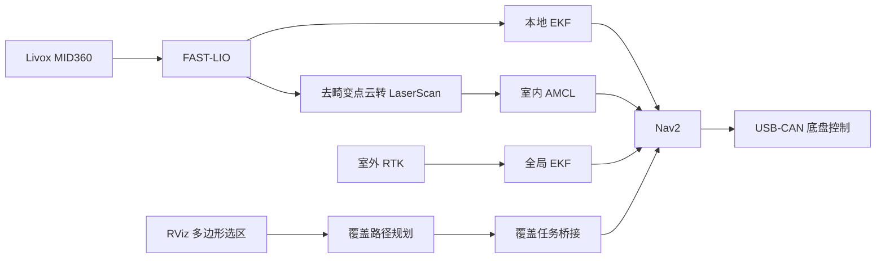

# Quantum Base Plate Navigation

**简体中文** | [English](README.en.md)

基于 **ROS 2 Humble** 的阿克曼底盘导航工作空间，集成 Livox MID360、FAST-LIO、Nav2 和覆盖路径规划，提供室内 AMCL 导航、室外 RTK 定位导航及独立覆盖路径预览入口。

## 功能概览

| 功能 | 实现 | 启动入口 |
| --- | --- | --- |
| 室内导航 | MID360 + FAST-LIO + 本地 EKF + AMCL + Nav2 | `robot_bringup indoor_amcl.launch.py` |
| 室外导航 | MID360 + FAST-LIO + RTK + 本地/全局 EKF + Nav2 | `robot_bringup outdoor_ekf.launch.py` |
| 覆盖路径预览 | RViz 多边形选区、条带生成与转弯路径可视化 | `wheeltec_nav2 coverage_preview.launch.py` |
| 覆盖任务执行 | 覆盖路径计算、前往作业起点、Nav2 路径跟踪 | 整车入口增加 `use_coverage:=true` |
| 底盘控制 | USB-CAN 通信、速度与转角换算、反馈查询 | `vehicle_can_bridge` |

室内、室外模式通过不同入口选择。覆盖预览可在没有底盘和传感器的开发电脑上运行。

## 系统结构



图中的 AMCL 和全局 EKF 分别属于室内、室外模式。两种模式的 TF 分工如下：

| 变换 | 室内模式 | 室外模式 |
| --- | --- | --- |
| `map → odom` | AMCL | 全局 EKF |
| `odom → base_link` | 本地 EKF | 本地 EKF |

FAST-LIO 输出 `/Odometry`，整车配置关闭其里程计 TF 发布，由本地 EKF 发布 `odom → base_link`。

## 环境与依赖

- Ubuntu 22.04、ROS 2 Humble。
- ROS 依赖包括 Nav2、`robot_localization`、`pointcloud_to_laserscan` 和 RViz2。
- 原生库包括 Livox-SDK2、Eigen、PCL 和 GeographicLib；覆盖规划还需要 Fields2Cover。
- 实车配置：Livox MID360、兼容当前 CAN 协议的阿克曼底盘，以及室外模式使用的 RTK 接收机。

**覆盖规划源码已随仓库提供：** `src/opennav_coverage/` 作为普通源码由主仓库跟踪，包含 `opennav_coverage`、`opennav_coverage_msgs` 及本地适配，克隆本项目即可获取。上游项目为 [OpenNav Coverage](https://github.com/open-navigation/opennav_coverage)，来源与本地修改见 [LOCAL_CHANGES.md](src/opennav_coverage/LOCAL_CHANGES.md)。

**Fields2Cover 仍需单独安装：** `.gitignore` 继续排除 `src/Fields2Cover/`，该库不随主仓库克隆。可从 [Fields2Cover 上游仓库](https://github.com/Fields2Cover/Fields2Cover) 获取源码；当前 [覆盖依赖清单](src/opennav_coverage/.github/deps.repos) 指定版本为 `v2.0.0`。

Livox-SDK2 的安装说明见 [Livox 驱动文档](src/livox_ros_driver2/README.md)。

## 获取与编译

以下步骤适用于已安装 ROS 2 Humble、`git`、`colcon` 和 `rosdep` 的 Bash 环境，按顺序执行。

### 1. 下载项目源码

在准备存放项目的目录中执行：

```bash
git clone https://github.com/wyz030210/quatum_base_plate_nav.git
```

该命令同时获取项目维护的 OpenNav Coverage 源码及本地适配，无需单独克隆该上游仓库或初始化子模块。

### 2. 进入工作空间根目录

```bash
cd YOUR_WORKSPACE
```

后续依赖安装、编译和环境加载命令均在此目录执行；源码位于其下的 `src/` 中。

### 3. 加载 ROS 2 Humble 环境

```bash
source /opt/ros/humble/setup.bash
```

### 4. 准备外部原生依赖

按照上方“环境与依赖”准备 Livox-SDK2 等原生库，并安装兼容的 Fields2Cover 库，版本参考 [覆盖依赖清单](src/opennav_coverage/.github/deps.repos) 中的 `v2.0.0`。

OpenNav Coverage 及其消息包已包含在 `src/opennav_coverage/` 中，后续由 `colcon` 随工作空间依赖一同编译。完成外部依赖准备后，再继续以下步骤；`rosdep` 不会自动获取被忽略的 Fields2Cover 源码。

### 5. 初始化并更新 rosdep

首次在这台电脑上使用 `rosdep` 时，先初始化系统级依赖源：

```bash
sudo rosdep init
```

如果此前已初始化，跳过这条命令。然后以当前普通用户更新依赖索引：

```bash
rosdep update
```

### 6. 安装源码声明的依赖

```bash
rosdep install --from-paths src --ignore-src --rosdistro humble -r -y
```

该命令扫描 `src/` 下各包的 `package.xml`，安装可解析的系统依赖。`--ignore-src` 跳过工作空间内已有的源码包，`--rosdistro humble` 指定 ROS 发行版，`-y` 自动确认安装。

`-r` 会在遇到错误后继续尝试其他依赖，因此命令结束后仍需检查输出；若有未解析或安装失败的依赖，应先处理再编译。

### 7. 编译整车启动包及其依赖

```bash
colcon build 
```

等待编译结束，确认终端汇总中没有失败或中止的包，再继续加载环境。

## 快速开始

以下命令均在已编译的工作空间根目录执行。

### 1. 在电脑上预览覆盖路径

```bash
source /opt/ros/humble/setup.bash
source install/setup.bash

ros2 launch wheeltec_nav2 coverage_preview.launch.py
```

在 RViz 中选择 **Publish Point**，沿区域边界依次点击至少三个顶点，再点击首点附近闭合多边形。规划成功后显示区域边界、覆盖路径和作业条带。

此入口只计算和显示路径，不启动底盘或导航执行。该终端的 ROS 域与本机通信设置仅用于独立预览；实车导航请使用其他终端，并与机器人保持一致的通信配置。

### 2. 室内 AMCL 导航

先确认雷达网络、底盘串口和地图；将命令中的地图路径与设备路径替换为实际值。

```bash
source /opt/ros/humble/setup.bash
source install/setup.bash

ros2 launch robot_bringup indoor_amcl.launch.py \
  map:=/absolute/path/to/indoor_map.yaml \
  can_serial_port:=/dev/serial/by-id/YOUR_CAN_DEVICE \
  use_rviz:=true
```

地图参数必须是存在的 YAML 文件的绝对路径，YAML 引用的图像也必须可读取。仓库内的地图位于 `src/wheeltec_nav2/map/`，使用前需确认地图适合当前场地。

启动后，通过 RViz 的 **2D Pose Estimate** 设置初始位姿，确认激光与地图对齐，再使用 **Nav2 Goal** 发送导航目标。无图形界面的车载电脑可设置 `use_rviz:=false`，从通信配置一致的电脑连接 RViz。

### 3. 室外 RTK 导航

```bash
ros2 launch robot_bringup outdoor_ekf.launch.py \
  map:=/absolute/path/to/outdoor_map.yaml \
  can_serial_port:=/dev/serial/by-id/YOUR_CAN_DEVICE \
  rtk_serial_port:=/dev/serial/by-id/YOUR_RTK_DEVICE \
  datum_lat:=YOUR_DATUM_LATITUDE \
  datum_lon:=YOUR_DATUM_LONGITUDE
```

将 `YOUR_...` 占位值替换后再执行。室外地图必须与 RTK 原点及 ENU 坐标方向配准；CAN 与 RTK 应使用各自独立的设备路径。室外入口使用全局 EKF 发布 `map → odom`，不启动 AMCL。

### 4. 按需启用覆盖任务

在室内或室外整车启动命令末尾增加：

```text
use_coverage:=true
```

该参数加载覆盖相关节点。覆盖执行动作入口为 `/execute_coverage_navpath`；任务发送后，桥接节点计算覆盖路径、引导车辆前往起点并交给 Nav2 跟踪。独立预览与实车任务的操作说明见下方文档。

## 常用配置

| 配置 | 路径 |
| --- | --- |
| MID360 网络与设备 IP | [`MID360_config.json`](src/livox_ros_driver2/config/MID360_config.json) |
| 室内 FAST-LIO | [`mid360_indoor.yaml`](src/fast_lio/src/FAST_LIO/config/mid360_indoor.yaml) |
| 本地 / 全局 EKF | [`ekf_odom.yaml`](src/wheeltec_nav2/param/wheeltec_params/ekf_odom.yaml) / [`ekf_map.yaml`](src/wheeltec_nav2/param/wheeltec_params/ekf_map.yaml) |
| 室内 Nav2 | [`param_mini_diff_indoor.yaml`](src/wheeltec_nav2/param/wheeltec_params/param_mini_diff_indoor.yaml) |
| 室外 Nav2 | [`param_mini_diff.yaml`](src/wheeltec_nav2/param/wheeltec_params/param_mini_diff.yaml) |
| 覆盖规划 | [`coverage_params.yaml`](src/wheeltec_nav2/param/coverage_params.yaml) |
| 覆盖任务示例 | [`coverage_navpath_task.yaml`](src/nav2_mission/config/coverage_navpath_task.yaml) |

整车入口默认前进速度上限为 **0.25 m/s**、倒车速度上限为 **0.10 m/s**、横摆角速度上限为 **0.50 rad/s**。通过 `max_forward_speed`、`max_reverse_speed` 和 `max_yaw_rate` 调整。车辆尺寸、雷达安装外参及转向参数需要与实际硬件一致。

## 运行检查与当前边界

室内启动后，可分别在已加载环境的终端检查：

```bash
ros2 topic hz /scan
ros2 topic hz /odometry/filtered_odom
ros2 lifecycle get /amcl
ros2 run tf2_ros tf2_echo map odom
ros2 run tf2_ros tf2_echo odom base_link
```

预期激光和里程计持续更新，AMCL 为 `active`，TF 链 `map → odom → base_link` 连续可用。

- 当前覆盖参数为作业宽度 **0.60 m**、条带中心距 **1.50 m**，直线条带之间会留下约 **0.90 m** 间隙；启用覆盖规划不等于已经完整覆盖区域。
- 外圈地头用于转弯预留，当前未独立覆盖。几何预览不检查实时障碍物，也不验证实车跟踪效果。
- 室外入口已具备独立启动配置，实车使用仍需验证 RTK 数据有效性、失联处理及地图配准。

## 目录与文档

```text
src/
├── robot_bringup/       # 室内 / 室外整车启动
├── wheeltec_nav2/       # Nav2、地图、行为树及覆盖参数
├── nav2_mission/        # 巡检、覆盖选区与任务桥接
├── opennav_coverage/    # 已纳入仓库的覆盖规划源码、消息与本地适配
├── vehicle_can_bridge/  # USB-CAN 底盘控制
├── livox_ros_driver2/   # Livox 雷达驱动
├── fast_lio/            # 激光惯性里程计
└── location/            # RTK 解析与坐标转换
doc/                    # 操作手册与调试说明
```

- [室内 AMCL 运行手册](doc/启动/INDOOR_AMCL_RUNBOOK.md)
- [室外 RTK 与双 EKF](doc/Outdoor_EKF.md)
- [覆盖路径预览与参数](doc/Coverage_Preview.md)
- [OpenNav Coverage 来源与本地适配](src/opennav_coverage/LOCAL_CHANGES.md)
- [底盘部署说明](src/vehicle_can_bridge/docs/DEPLOYMENT.md)
- [底盘协议与架构](src/vehicle_can_bridge/docs/ARCHITECTURE.md)

部分历史文档和脚本仍保留旧工作空间路径或旧参数。启动入口以当前 `src/robot_bringup/launch/`、配置以源码 YAML 为准。

## 致谢

本项目集成 ROS 2 / Nav2、FAST-LIO、Livox ROS Driver 2、OpenNav Coverage、Fields2Cover，以及相关底盘驱动代码。各组件的来源与许可请参阅对应目录及上游项目说明。
