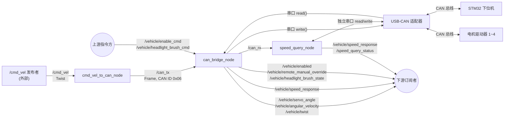
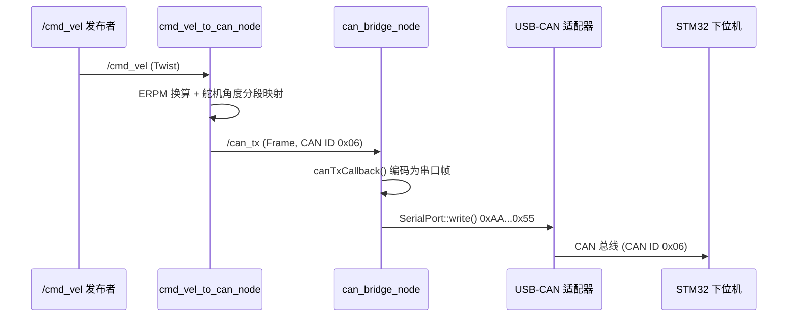
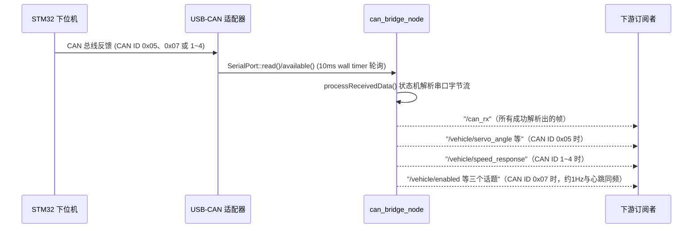
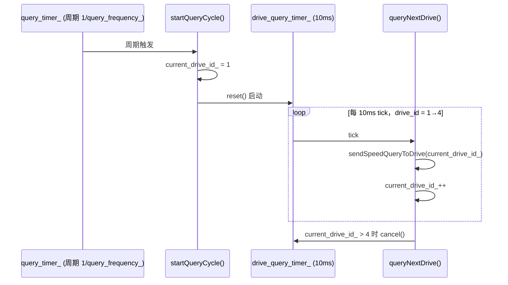
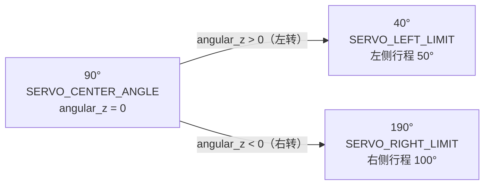
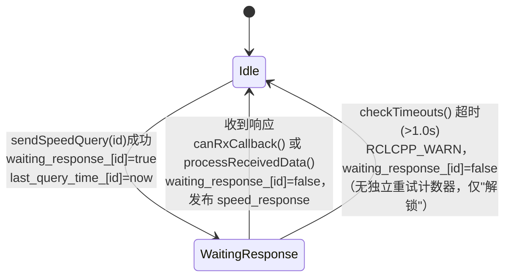

# vehicle_can_bridge（ROS2）架构走读

> 面向维护者的代码走读文档，不是安装/使用指南。所有描述均对照本包源码逐文件核实。
> 本包是外部 ROS1 (catkin) 包 `vehicle_can_bridge`（来源 `https://github.com/liuchongxiao/vehicle_can_bridge`）到 ROS2 Humble 的**忠实移植**：话题名、参数名、CAN 协议字节格式、ERPM/舵机角度换算公式与原包逐字节一致，只做 ROS1→ROS2 API 翻译，不做任何行为优化或"顺手修 bug"。移植的设计决策见 `docs/superpowers/specs/2026-07-11-vehicle-can-bridge-ros2-port-design.md`，逐 Task 实现拆解见 `docs/superpowers/plans/2026-07-11-vehicle-can-bridge-ros2-port.md`（本文档基于两者及实际源码整理，只讲"代码现在长什么样、为什么长这样"）。
> 本包**不接入**本仓库 `AGV_Navigation` 现有的 ZMQ 通信体系（不注册进 `launch.py`/`show_topology.py`/`port_allocator.py`），是独立摆放供未来 ROS2 生态（如 nav2/cartographer）场景使用的包。

## 1. 系统总览

下图是整个包的节点/话题拓扑总览：3 个节点通过 `/can_tx`、`/can_rx`、`/vehicle/*` 等话题互联，并与外部的 `/cmd_vel` 发布者、USB-CAN 适配器、STM32 下位机、4 个电机驱动器相连。



### 1.1 下发方向（控制链路）

```
/cmd_vel (geometry_msgs/Twist)
        │
        ▼
┌───────────────────────┐
│  cmd_vel_to_can_node   │  ERPM 换算 + 舵机角度分段映射
│  (可执行 cmd_vel_to_can)│
└───────────────────────┘
        │ 发布 vehicle_can_bridge/msg/Frame（CAN ID 0x06 组合控制帧）
        ▼
    /can_tx (Frame)
        │
        ▼
┌───────────────────────┐
│    can_bridge_node     │  Frame → USB-CAN 适配器串口帧（0xAA...0x55）
│    (可执行 can_bridge)  │
└───────────────────────┘
        │ SerialPort::write()
        ▼
   USB 串口 (/dev/ttyUSB0, 2000000 baud)
        │
        ▼
   USB-CAN 适配器 → CAN 总线 → STM32 下位机
```

下面用时序图展开同一条控制链路的调用顺序：



**2026-07-13 新增的两个直连命令话题**（不经过 `cmd_vel_to_can_node`，直接由 `can_bridge_node` 自己订阅并编码发送，同样落在 CAN ID `0x06`、只是 `data[0]` command_type 不同）：`/vehicle/enable_cmd`（Bool，`command_type=0x04`，写 CAN 使能状态）、`/vehicle/headlight_brush_cmd`（Bool，`command_type=0x05`，控制 PF0 头灯/滚刷合并继电器）。`scripts/keyboard_control.py` 的 `l` 键即发布到 `/vehicle/headlight_brush_cmd`。详见 2.1 节和第 4 节协议表。

### 1.2 反馈方向

```
STM32 下位机 → CAN 总线 → USB-CAN 适配器 → USB 串口
        │
        ▼ SerialPort::read() / available()（10ms wall timer 轮询）
┌───────────────────────┐
│    can_bridge_node      processReceivedData() 状态机解析串口字节流
└───────────────────────┘
        │
        ├─► /can_rx (Frame)                     所有成功解析出的 CAN 帧（原样转发）
        │
        ├─► CAN ID 0x05（舵机角度反馈，2 字节大端）
        │       ├─► /vehicle/servo_angle (Float32)       原始角度值 0~180
        │       ├─► /vehicle/angular_velocity (Float32)  角度微分算出的角速度，clamp ±2.0 rad/s
        │       └─► /vehicle/twist (Twist)                仅 angular.z 有效，供里程计消费
        │
        ├─► CAN ID 1~4（测速响应，[0x0F,0x01]+ERPM 4字节大端）
        │       └─► /vehicle/speed_response (String)      "Drive N Speed: X ERPM (Y RPM)"
        │
        └─► CAN ID 0x07（2026-07-13 新增，DLC=3，与心跳同频周期性帧，非请求/响应）
                ├─► /vehicle/enabled (Bool)                 data[0]，最终使能状态（RC状态+CAN可写位合并结果）
                ├─► /vehicle/remote_manual_override (Bool)  data[1]，遥控器是否手动接管（1=ROS指令此刻被固件忽略）
                └─► /vehicle/headlight_brush_state (Bool)   data[2]，PF0头灯/滚刷合并继电器当前实际状态（权威回读）
```

同样用时序图展开反馈方向的调用顺序（`can_bridge_node` 每 10ms 轮询一次串口）：



### 1.3 独立的测速查询循环

`speed_query_node` 是**独立**于 `cmd_vel_to_can_node`/`can_bridge_node` 控制链路的第三个节点，对 4 个电机驱动器（CAN ID 1~4）做各自独立的"查询→等响应→超时重试"循环：

```
speed_query_node --sendSpeedQuery(id)--> 自己的串口 --> CAN 总线（驱动器 1~4）
speed_query_node <--canRxCallback()------ /can_rx (由 can_bridge_node 发布)
speed_query_node <--processReceivedData()- 自己的串口（直接读，不经过 can_bridge_node）
        │
        └─► /vehicle/speed_response (String)
        └─► /speed_query_status (String)   "Speed Query Status: Connected, Queries: N, Responses: M"
```

注意 `speed_query_node` **自己也开了一路独立的串口连接**（`connectSerial()`/`setupCAN()`/`startReading()`，与 `can_bridge_node` 各自持有自己的 `SerialPort` 实例），并**同时**有两条测速响应解析路径：订阅 `/can_rx`（消费 `can_bridge_node` 解析好的帧）+ 自己直接解析串口字节流。这是原 ROS1 代码本来的设计（两个节点各连一次串口，互不知道对方），移植时原样保留，不是移植引入的重复。此外它创建了 `/can_tx` publisher（`can_tx_pub_`）但**从未调用其 `publish()`**——`sendSpeedQuery()` 是直接写自己的串口，这是原包的死代码，移植时逐字照抄（见 `src/speed_query_node.cpp` 文件头注释）。

`cmd_vel_to_can_node` 和 `can_bridge_node`/`speed_query_node` 之间没有直接依赖，只通过 `/can_tx`、`/can_rx` 两个 topic 解耦。

## 2. 三个节点

### 2.1 `can_bridge_node`（可执行文件 `can_bridge`，源码 `src/can_bridge_node.cpp`）

串口↔CAN 桥接核心节点，构造函数节点名固定为 `"can_bridge_node"`（`rclcpp::Node("can_bridge_node")`），但用到这个节点的 launch 文件（`auto_control.launch.py`、`complete_control.launch.py`）都用 `name='can_bridge'` 覆盖了运行时节点名——这是原 ROS1 `.launch` 里 `<node name="can_bridge" ...>` 本来就有的覆盖，移植时照抄，不是新引入的不一致。

**串口生命周期**：构造函数里 `connectSerial()` 成功后依次 `setupCAN()`（发送 CAN 适配器配置命令 `{0xAA,0x55,0x12,0x03,0x01,...}` 共 19 字节 + 校验和，`sleep 500ms` 后 `serial_.read(100)` 读一次响应做日志）、`startReading()`（`flushInput()`+`flushOutput()`）。

**帧解析状态机**（`processReceivedData()`）：从 `rx_buffer_`（类成员，原 ROS1 代码里是函数级 `static std::vector<uint8_t> buffer`，移植为成员避免多实例共享状态）里找 `0xAA` 帧头，根据控制字节判定帧长：

- CAN 数据帧（`control_byte & 0xC0 == 0xC0`）：标准帧 `frame_length = 5 + data_length`，扩展帧 `frame_length = 7 + data_length`——**均不包含**尾部 `0x55` 字节。
- `control_byte == 0x55`（设备状态帧）：`frame_length = 20`（固定）。
- 其它：`frame_length = 5`（兜底假设）。

`processReceivedData()` 拿到 `frame_length` 字节后**不校验帧尾**是否为 `0x55`，直接按 `frame_data[0]==0xAA && (frame_data[1]&0xC0)==0xC0` 判定并解析。这个"标准帧长不含 0x55 且不校验帧尾"的口径是 `can_bridge_node` 特有的，与 `speed_query_node` 的口径不同（见 2.3 节及第 4 节协议表），**是上游代码本身的不一致，移植时按红线要求逐节点各自照抄，不允许"顺手统一"**。

解析出标准帧后：发布到 `/can_rx`；若 `can_id` 在 1~4 且 `data_len>=6` 且 `data[4..5]==[0x0F,0x01]`，视为测速响应，ERPM=`data[6..9]` 大端，`rpm=erpm/15.0`（写死 15，不读 `motor_pole_pairs` 参数——这与 `speed_query_node` 用参数化的 `motor_pole_pairs_` 不同，也是原包差异，照抄），发布 `/vehicle/speed_response`；若 `can_id==0x05` 且 `data_len==2`，视为舵机角度反馈，`angle_raw = data[4]<<8 | data[5]`（大端），发布 `/vehicle/servo_angle`。

**2026-07-13 新增：CAN ID 0x07 反馈帧解析**（`data_len==3`，三个独立的单字节 0/1 标量，不涉及字节序，逐字节直接 `!= 0` 判断后各自发布）：`data[4]`（即协议里的 `data[0]`）→ `/vehicle/enabled`；`data[5]`（协议 `data[1]`）→ `/vehicle/remote_manual_override`；`data[6]`（协议 `data[2]`）→ `/vehicle/headlight_brush_state`。这个分支和 CAN ID 0x05 分支是同级并列的独立 `if`，不共享状态，也不做角速度微分之类的历史依赖计算（每次 0x07 帧到达都是独立的三次纯转发式发布）。同时新增了两个 ROS→STM32 方向的命令订阅（不在这套解析分支里，是构造函数里新增的两个独立 `Bool` subscription）：`/vehicle/enable_cmd`（`enableCmdCallback`，编码 CAN ID `0x06`、`data[0]=0x04`）、`/vehicle/headlight_brush_cmd`（`headlightBrushCmdCallback`，编码 CAN ID `0x06`、`data[0]=0x05`），两者都复用既有 `sendFrame()` 发送路径，DLC=2，`data[1]=msg->data?1:0`。

**角度→角速度微分**：舵机分支里用 `last_servo_angle_`/`last_time_` 两个成员（原 ROS1 是函数级 `static double last_servo_angle` / `static ros::Time last_time`，"首次执行到该分支时一起初始化一次"的语义用 `last_servo_angle_initialized_` 标志复现）算 `dt = (current_time - last_time_).seconds()`，`angular_velocity = (angle_change * π/180) / dt`，clamp 到 `[-2.0, 2.0]` rad/s，发布 `/vehicle/angular_velocity` 和 `/vehicle/twist`（只填 `angular.z`）。`dt<=0`（含首帧）时不发布这两个话题，也不更新 `last_servo_angle_`/`last_time_`——这一步是原代码固有行为。

**自动测速查询的双定时器机制**：仅当 `auto_query_enabled_ && query_frequency_ > 0.0` 时创建：

- `query_timer_`：周期 `1.0/query_frequency_` 秒，回调 `startQueryCycle()`——每个周期把 `current_drive_id_` 置 1，然后 `drive_query_timer_->reset()` 启动第二个定时器。
- `drive_query_timer_`：固定 10ms 周期，创建后立即 `->cancel()`（对齐原 ROS1 `nh_.createTimer(..., oneshot=false, autostart=false)` 的"建好但不自动启动"语义）。回调 `queryNextDrive()`：若 `current_drive_id_` 越界（`<1` 或 `>4`）则 `->cancel()` 停止；否则 `sendSpeedQueryToDrive(current_drive_id_)`（构造 `id=drive_id, dlc=2, data=[0x0F,0x01]` 帧发送），`current_drive_id_++`，若递增后 `>4` 也 `->cancel()`。

也就是说每个查询周期里，`drive_query_timer_` 以 10ms 间隔连续查询驱动器 1→2→3→4（共 4 次 tick 后停），而不是一次性把 4 条查询帧连续发出——这个"逐驱动器分 tick 发送"的节奏是原代码的设计，照抄。

下图展示这套双定时器机制的时序关系：



**为什么用 `create_wall_timer` 轮询而不是原 ROS1 的阻塞 `while(ros::ok())` 循环**：原 ROS1 代码里 `run()` 是 `ros::Rate(100) while(ros::ok()){ processReceivedData(); 每100次 publishStatus(); ros::spinOnce(); rate.sleep(); }`，节点 `main()` 直接调用 `run()` 而不是 `ros::spin()`。ROS2 的 `rclcpp::spin(node)` 本身就是阻塞的事件循环，节点代码不能再自己写一个阻塞 `while` 循环去手动驱动回调（那样会跟 `spin()` 冲突/根本跑不到）。因此移植时把 `run()` 循环体改写为 `poll_timer_ = create_wall_timer(10ms, &CANBridgeNode::pollLoop)`：`pollLoop()` 里每 tick 调 `processReceivedData()`，用成员计数器 `status_counter_` 累计到 100 次（对应原 100Hz×100tick≈1 秒）后调 `publishStatus()` 并清零。`main()` 变为标准的 `rclcpp::init → make_shared<CANBridgeNode> → rclcpp::spin(node) → rclcpp::shutdown`。这是本包移植过程中风险最高的非机械翻译点（原计划文档标注为"高风险"）。

publisher/subscriber 一览：`can_rx_pub_`(`/can_rx`,Frame,depth 100)、`status_pub_`(`/can_bridge_status`,String,10)、`speed_response_pub_`(`/vehicle/speed_response`,String,10)、`servo_angle_pub_`(`/vehicle/servo_angle`,Float32,10)、`angular_velocity_pub_`(`/vehicle/angular_velocity`,Float32,10)、`twist_pub_`(`/vehicle/twist`,Twist,10)、`enabled_pub_`(`/vehicle/enabled`,Bool,10，2026-07-13新增)、`remote_manual_override_pub_`(`/vehicle/remote_manual_override`,Bool,10，2026-07-13新增)、`headlight_brush_state_pub_`(`/vehicle/headlight_brush_state`,Bool,10，2026-07-13新增)、`can_tx_sub_`(`/can_tx`,Frame,100,回调 `canTxCallback`)、`speed_query_sub_`(`/vehicle/speed_query`,UInt8,10,回调 `speedQueryCallback`——外部可发单个 drive_id 的 uint8 触发一次性查询，与自动双定时器机制并行存在、互不冲突)、`enable_cmd_sub_`(`/vehicle/enable_cmd`,Bool,10,回调 `enableCmdCallback`，2026-07-13新增)、`headlight_brush_cmd_sub_`(`/vehicle/headlight_brush_cmd`,Bool,10,回调 `headlightBrushCmdCallback`，2026-07-13新增)。

### 2.2 `cmd_vel_to_can_node`（可执行文件 `cmd_vel_to_can`，源码 `src/cmd_vel_to_can_node.cpp`）

本包中最直接的一个节点：无串口、无自驱动循环，原 ROS1 版本本来就是 `ros::spin()`，`main()` 1:1 对应 `rclcpp::spin(node)`。核心逻辑全部在 `cmdVelCallback()` → `sendCombinedControlCommand(linear_x, angular_z)` 里。

**ERPM 换算**（`sendCombinedControlCommand` 内）：

```
motor_erpm = (int32_t)( linear_x * 60.0 / (2π * wheel_radius_) * MOTOR_POLE_PAIRS * GEAR_RATIO )
max_erpm   = 同式，linear_x 换成 max_linear_speed_
motor_erpm = clamp(motor_erpm, -max_erpm, max_erpm)
```

`MOTOR_POLE_PAIRS=15`、`GEAR_RATIO=1.0f` 是匿名命名空间里的 `constexpr` 常量（对应原 ROS1 的 `#define` 宏），与 STM32 固件端约定一致，不是 ROS2 参数。`linear_x`/`angular_z` 在换算前已先按 `linear_scale_`/`angular_scale_` 缩放并 clamp 到 `±max_linear_speed_`/`±max_angular_speed_`。

**舵机角度分段映射（非对称，硬件/协议本身设计如此，不是 bug）**：

- 中心角度 `SERVO_CENTER_ANGLE = 90.0`°
- 左极限 `SERVO_LEFT_LIMIT = 40.0`°（左侧行程 = 90-40 = **50°**）
- 右极限 `SERVO_RIGHT_LIMIT = 190.0`°（右侧行程 = 190-90 = **100°**）

下图直观展示三个角度常量与转向方向的对应关系（注意左右行程不等长，右侧是左侧的两倍）：



```
angular_z > 0（左转）：
    left_range = 90 - 40 = 50
    norm = min(angular_z / max_angular_speed_, 1.0)
    servo_angle = 90 - norm * 50            // 范围 [40, 90]

angular_z < 0（右转）：
    right_range = 190 - 90 = 100
    norm = min(-angular_z / max_angular_speed_, 1.0)
    servo_angle = 90 + norm * 100           // 范围 [90, 190]

angular_z == 0：
    servo_angle = 90

最终：servo_angle = clamp(servo_angle, 40, 190)
```

左右两侧行程比例是 1:2（50° vs 100°），意味着相同的归一化角速度输入，右转时舵机实际转动的角度是左转的两倍。这个不对称性来自舵机在车辆上的实际机械行程/线控转向的帧格式定义（`servo_left_limit`/`servo_right_limit` 参数），是硬件+协议既定事实，移植时逐字复刻这三个常量和两段公式，**不要"对称化"或"修正"这个映射**。

**组合控制帧编码**（CAN ID `0x06`，`data` 共 8 字节，发布到 `/can_tx`）：`data[0]=0x01`（`CMD_TYPE_COMBINED`），`data[1..4]` = `motor_erpm` 大端 4 字节，`data[5..6]` = `(int16_t)servo_angle` 大端 2 字节，`data[7]=0x00`（保留字节）。每次 `/cmd_vel` 回调都会额外发布一次 `/control_mode`（Int32，`auto_mode_?1:0`；`auto_mode_` 恒为 `false`，代码里未提供修改它的接口，是原包遗留的死状态量，照抄）。

### 2.3 `speed_query_node`（可执行文件 `speed_query`，源码 `src/speed_query_node.cpp`）

**按驱动器 ID 的超时/重试状态机**：`waiting_response_`（`std::map<int,bool>`，key 1~4）标记该驱动器是否有一次查询在等响应；`last_query_time_`（`std::map<int,rclcpp::Time>`）记录每个驱动器最近一次发查询的时间戳，两者都由 `sendSpeedQuery(drive_id)` 在发帧成功后设置（`waiting_response_[id]=true`、`last_query_time_[id]=now`）。`checkTimeouts()` 每 tick 遍历 1~4，若 `waiting_response_[i]==true` 且 `(now - last_query_time_[i]).seconds() > 1.0`，判定超时：`RCLCPP_WARN` 并把 `waiting_response_[i]` 置回 `false`（允许下一轮重新查询），**没有独立的重试计数器**，超时后只是"解锁"让下个周期能再发一次。

下图是**每个驱动器 ID（1~4，各自独立）**的状态机，状态名对应 `waiting_response_[id]` 的取值：



`pollLoop()`（`create_wall_timer(100ms, ...)`，替代原 `ros::Rate(10) while(ros::ok())` 循环，同样因为 `rclcpp::spin` 阻塞不能沿用手写循环）里查询周期门控用的是**新增的独立标量成员** `last_query_cycle_time_`，对应原 ROS1 `run()` 函数体内一个**局部标量** `ros::Time last_query_time`（无下划线，非 map）——这个局部标量与类成员 `last_query_time_`（有下划线、是逐驱动器 map）只是命名相近，含义完全不同，容易混淆：`last_query_cycle_time_` 只用于判断"是否到了该发起下一轮批量查询的时间"（`(now - last_query_cycle_time_).seconds() >= 1.0/query_frequency_`，到期则对 1~4 中 `!waiting_response_[i]` 的驱动器逐个 `sendSpeedQuery(i)`），`last_query_time_` map 只服务 `checkTimeouts()`/`sendSpeedQuery()` 的逐驱动器超时判断，`pollLoop()` 本身不直接读写这个 map。未来改动这块逻辑时务必分清这两个变量，不要合并或混用。

**RX 帧长口径与 `can_bridge_node` 故意不同——这是上游真实存在的不一致，是刻意保留的，不是 bug**：`speed_query_node::processReceivedData()` 里标准帧 `frame_length = 5 + data_length + 1`，扩展帧 `frame_length = 7 + data_length + 1`，**+1 是算上尾部 `0x55`**；解析时会取 `end_marker = frame_data[4+data_len]` 并校验 `end_marker == 0x55`，不等则 `RCLCPP_WARN`（仅 `enable_debug_` 时打印）并 `continue` 丢弃整帧，重新从 buffer 里下一个字节找帧头。这与 `can_bridge_node`（`5+data_length` 不含 `0x55`、完全不校验帧尾）是两种不同口径。**未来维护者不要把两边"顺手"统一成同一套逻辑**——那样会改变各自的实际行为（比如给 `can_bridge_node` 加上帧尾校验可能导致它在某些边界情况下丢帧/移位；给 `speed_query_node` 去掉 +1 会导致它把下一帧的第一个字节当成本帧数据解析）。这一差异在计划文档的"忠实移植红线"第 4 条中被明确列为必须保留的原包行为。

`speed_query_node` 有**两条独立**的测速响应解析路径，都会更新同一份 `drive_speeds_`/`waiting_response_`/`response_count_` 状态并发布 `/vehicle/speed_response`：

- (a) `canRxCallback()`：订阅 `/can_rx`（`can_bridge_node` 发布），消费已经被 `can_bridge_node` 解析好的 `Frame` 消息，`msg->id∈[1,4] && msg->dlc>=6 && data[0..1]==[0x0F,0x01]` 时取 `data[2..5]` 大端为 ERPM。
- (b) `processReceivedData()`：直接读自己独有的那路串口连接的原始字节流，走上述"含 `0x55`"的帧长口径，ERPM 取 `frame_data[6..9]` 大端（因为多算了 2 字节 CAN ID 偏移，位置比 (a) 里的 `msg->data` 数组靠后）。

`rpm = erpm / motor_pole_pairs_`（`motor_pole_pairs_` 是声明的参数，默认 15，与 `can_bridge_node` 里写死的 `/15.0` 不同——两节点各自独立换算，互不通信）。`setupCAN()` 在此节点里**没有**读设备响应这一步（`can_bridge_node::setupCAN()` 发完配置命令后有 `serial_.read(100)`，本节点只有 `sleep(500ms)` 就结束），这也是原包的不对称，照抄不补。

publisher/subscriber：`can_tx_pub_`(`/can_tx`,Frame,10，**创建但从未 publish**)、`speed_pub_`(`/vehicle/speed_response`,String,10)、`status_pub_`(`/speed_query_status`,String,10)、`can_rx_sub_`(`/can_rx`,Frame,100,回调 `canRxCallback`)。

## 3. 支撑部件

### 3.1 `msg/Frame.msg`

```
std_msgs/Header header
uint32 id
bool is_rtr
bool is_extended
bool is_error
uint8 dlc
uint8[8] data
```

原 ROS1 包用的是外部包 `can_msgs::Frame`（来自 `ros_canopen` 生态）。ROS2 没有官方保证可用的等价物，且目标编译环境 `kwhq-ubuntu` 上未安装任何 `can_msgs`/`socketcan` 相关包。为避免绑定一个不确定存在的外部依赖，本包在内部自带该消息定义，字段与原 `can_msgs/Frame` 完全一致，唯一差异是消息类型路径变成了 `vehicle_can_bridge/msg/Frame`（而不是 `can_msgs/Frame`）——这是设计上唯一允许的类型路径级偏差，不影响协议字节内容或节点行为。`CMakeLists.txt` 里通过 `rosidl_generate_interfaces(${PROJECT_NAME} "msg/Frame.msg" DEPENDENCIES std_msgs)` 生成，三个可执行文件都要 `rosidl_get_typesupport_target(cpp_typesupport_target ${PROJECT_NAME} "rosidl_typesupport_cpp")` 后 `target_link_libraries(<exe> "${cpp_typesupport_target}")`——因为 Humble 下 C++ 目标链接的是**本包自己生成**的消息 typesupport，写法与链接外部包的消息不同，如果新增可执行文件忘记这一步会在链接期报找不到符号。

### 3.2 `include/vehicle_can_bridge/serial_port.hpp`

原 ROS1 包依赖的 `serial`（wjwwood/serial）是 ROS1 专属库，没有官方 ROS2 移植版，目标环境也未安装 `libserial`。因此本包在头文件里自带一个只覆盖三个节点实际用到的接口子集的极简 POSIX `termios` 封装：`setPort`/`setBaudrate`/`setTimeout(ms)`/`open`/`close`/`isOpen`/`write(vector<uint8_t>)`/`read(max_len)→string`/`available()→size_t`/`flushInput`/`flushOutput`，命名空间 `vehicle_can_bridge`，类名 `SerialPort`（故意不叫 `serial::Serial`，避免与被替代的第三方包混淆）。所有方法内联定义在类体内，头文件可被多个编译单元安全 `#include`。

**关键实现细节**：

- `open()` 用 `O_RDWR | O_NOCTTY | O_NONBLOCK` 打开 fd，`tcgetattr`→`cfmakeraw`→设置 8N1（`CS8`，清 `PARENB`/`CSTOPB`）、关软硬件流控（清 `CRTSCTS`、清 `IXON|IXOFF|IXANY`），`tty.c_cc[VMIN]=0; tty.c_cc[VTIME]=0`——即**读超时逻辑完全不依赖 termios 的 VMIN/VTIME 机制**，而是 fd 非阻塞 + 用户态 `poll()` 自己控制超时，这样无论一次请求读多少字节，行为都一致（不会因为 VTIME 粒度问题产生和请求字节数相关的差异）。
- `write()`：循环 `::write()`，遇 `EAGAIN`/`EWOULDBLOCK` 用 `poll(POLLOUT, timeout_ms_)` 等待可写，超时则抛 `IOException`；遇 `EINTR` 重试。
- `read(max_len)`：用 `steady_clock` 算出 `deadline = now + timeout_ms_`，循环用 `poll(POLLIN, remaining_ms)` 等数据到来，`poll` 返回 0（超时）或读满 `max_len` 就跳出并返回已累积的内容（可能为空）——这就是"超时内尽量返回可用数据"的语义，不强求读满 `max_len` 才返回，对应原三个节点里 `serial_.read(available)`/`serial_.read(100)` 这类调用点不要求精确字节数的用法。
- `available()`：`ioctl(fd_, FIONREAD, &n)`。
- 波特率：非标准的 `2000000` 通过 `baudToSpeed()` 静态查表函数映射到 termios 的 `B2000000` 常量（`<termios.h>` 里 Linux 定义的非 POSIX 标准扩展常量，已在目标工具链/内核上确认可用，见头文件顶部注释），`cfsetispeed`/`cfsetospeed` 直接使用；不支持的波特率会抛 `IOException`。该函数同时覆盖了 1200~4000000 之间的一整套标准 `B*` 常量，不只是 2000000 这一个值。
- 异常类型 `vehicle_can_bridge::IOException`（派生自 `std::runtime_error`）对应原 `serial::IOException`，三个节点里 `catch (const vehicle_can_bridge::IOException & e)` 对齐原来的 catch 点，`e.what()` 返回可读错误信息。

## 4. 线协议（简述，字节级完整表格见协议速查）

USB-CAN 适配器串口帧格式：`0xAA` 帧头 + 控制字节（标准帧 `0xC0|dlc`、扩展帧 `0xE0|dlc`，低 4 位是 `dlc`）+ CAN ID（小端 2 字节）+ 数据（`dlc` 字节）+ `0x55` 帧尾（**仅 TX 方向必须携带**；RX 方向两个节点对帧尾的处理不同，见第 2.1/2.3 节）。

```mermaid
flowchart LR
    A["0xAA<br/>帧头"] --> B["控制字节<br/>标准帧 0xC0&#124;dlc<br/>扩展帧 0xE0&#124;dlc"]
    B --> C["CAN ID<br/>小端 2 字节"]
    C --> D["数据<br/>dlc 字节 (0~8B)"]
    D --> E["0x55 帧尾<br/>仅 TX 必须携带<br/>RX 两节点口径不同"]
```



本包收发的 CAN 层消息：
- **CAN ID `0x06`**：ROS→STM32 的 ROS 控制方向帧，`data[0]`（command_type）区分子命令：
  - `0x01`（组合控制，`cmd_vel_to_can_node` 产生）：`data=[0x01, ERPM 4B大端, servo 2B大端, 0x00]`
  - `0x02`（电机单独控制）、`0x03`（舵机单独控制）：既有子命令，各自负载见对应发送点
  - `0x04`（2026-07-13 新增，CAN 使能状态写命令，`can_bridge_node` 的 `/vehicle/enable_cmd` 触发）：DLC=2，`data=[0x04, 0/1]`，`0`=禁用、非0=启用（固件上电默认值也是启用）
  - `0x05`（2026-07-13 新增，PF0 头灯/滚刷合并继电器开关命令，`can_bridge_node` 的 `/vehicle/headlight_brush_cmd` 触发）：DLC=2，`data=[0x05, 0/1]`，`0`=关、非0=开
- **CAN ID `0x05`**：STM32→ROS 的舵机角度反馈，2 字节大端。
- **CAN ID `0x07`**（2026-07-13 新增）：STM32→ROS 反馈帧，与心跳同频周期性发送（约1Hz，非请求/响应）。DLC=3，三个独立的 0/1 字节：`data[0]`=最终使能状态（RC状态+CAN可写位合并结果）、`data[1]`=remote_manual_override（遥控器是否手动接管，1=ROS指令此刻被固件忽略）、`data[2]`=headlight_brush_state（PF0头灯/滚刷合并继电器当前实际状态，权威回读）。
- **CAN ID `1`~`4`**：ROS↔各电机驱动器的独立测速查询/响应，查询 `data=[0x0F,0x01]`，响应含 4 字节大端 ERPM。
- CAN 适配器自身配置命令：`{0xAA,0x55,0x12,0x03,0x01,...}`（19 字节）+ 校验和（从 index 2 起累加 `&0xff`）。

逐字节偏移的完整表格不在本文重复，查 memory 文件 `reference_vehicle_can_bridge_ros.md`（路径：`~/.claude/projects/-Users-kwhq-Documents-WorkSpace-AGV-Navigation/memory/reference_vehicle_can_bridge_ros.md`）。

## 5. ROS1 → ROS2 移植要点

| ROS1 | ROS2 | 本包实际写法 |
|---|---|---|
| `private_nh_.param(name, var, default)` | `declare_parameter` + `get_parameter` | 三节点均用 `declare_parameter<T>(name, default)` 返回值直接赋成员（`initParameters()` 里） |
| `ros::Publisher::advertise<T>(topic, queue_size)` | `create_publisher<T>(topic, qos)` | `queue_size` 数值原样映射为 `rclcpp::QoS(depth)` 的 depth（如 `/can_rx`/`/can_tx`(can_bridge侧)=100、其余多数=10） |
| `nh_.createTimer(period, cb, oneshot, autostart)` | `create_wall_timer(period, cb)` + 手动 `cancel()`/`reset()` | `can_bridge_node` 的 `drive_query_timer_` 建后立即 `cancel()`，`startQueryCycle()` 里 `reset()` 复现 `autostart=false` |
| 手写 `while(ros::ok())` 自驱动 `run()` 循环 | `rclcpp::spin(node)` + `create_wall_timer` 周期回调 | `can_bridge_node`：`run()`(100Hz) → `pollLoop()` 10ms wall timer；`speed_query_node`：`run()`(10Hz) → `pollLoop()` 100ms wall timer；两处都标为高风险的非机械翻译点 |
| `ROS_INFO/WARN/ERROR/DEBUG(...)` | `RCLCPP_INFO/WARN/ERROR/DEBUG(this->get_logger(), ...)` | 逐处替换，日志文本原样保留（含中文） |
| `ros::Time::now()` / `(t1-t0).toSec()` | `this->now()` / `(t1-t0).seconds()` | 用于舵机角速度微分、超时判断 |
| 函数级 `static` 局部变量（跨调用保持状态） | 类成员变量 | `rx_buffer_`、`last_servo_angle_`/`last_time_`（+`_initialized_`标志）、`status_counter_` |
| `ros::init(argc, argv, "node_name")` + `ros::spin()` | `rclcpp::init(argc, argv)` + `make_shared<Node>()` + `rclcpp::spin(node)` + `rclcpp::shutdown()` | 三节点 `main()` 均如此，节点名固定在构造函数里 `rclcpp::Node("xxx_node")` 传入 |
| `catkin` / `roscpp`/`rospy`/`can_msgs`/`serial` 依赖 | `ament_cmake` / `rclcpp`+`std_msgs`+`geometry_msgs`+`rosidl_default_generators` | `package.xml` format 3，删除所有 ROS1 专属/外部依赖 |
| XML `.launch`（`<node pkg= type= name=>` + `<param>`） | `.launch.py`（`launch_ros.actions.Node(package=, executable=, name=, parameters=[{...}])`） | 4 个文件逐一改写，参数值原样保留，`name=` 覆盖沿用原 XML 里的覆盖关系（如 `can_bridge` 源码默认名是 `can_bridge_node`，但 launch 里覆盖成 `can_bridge`） |

## 6. Topic / 参数速查表

### 6.1 Topic

| Topic | 方向 | 类型 | 所属节点 |
|---|---|---|---|
| `/cmd_vel` | 订阅 | `geometry_msgs/msg/Twist` | `cmd_vel_to_can_node` |
| `/can_tx` | 发布（cmd_vel_to_can_node）/ 订阅（can_bridge_node） | `vehicle_can_bridge/msg/Frame` | `cmd_vel_to_can_node`（发）、`can_bridge_node`（收，回调 `canTxCallback`）、`speed_query_node`（声明了 publisher `can_tx_pub_` 但从未调用 `publish()`，死代码） |
| `/control_mode` | 发布 | `std_msgs/msg/Int32` | `cmd_vel_to_can_node`（`auto_mode_?1:0`，`auto_mode_` 恒为 false） |
| `/can_rx` | 发布（can_bridge_node）/ 订阅（speed_query_node） | `vehicle_can_bridge/msg/Frame` | `can_bridge_node`（发，depth 100）、`speed_query_node`（收，回调 `canRxCallback`，depth 100） |
| `/can_bridge_status` | 发布 | `std_msgs/msg/String` | `can_bridge_node`（约 1Hz，"CAN Bridge Status: Connected/Disconnected, RX: n, TX: n"） |
| `/vehicle/speed_response` | 发布 | `std_msgs/msg/String` | `can_bridge_node`（自动测速查询响应）、`speed_query_node`（`canRxCallback`+`processReceivedData` 两条路径均发） |
| `/vehicle/servo_angle` | 发布 | `std_msgs/msg/Float32` | `can_bridge_node`（CAN ID 0x05 反馈，原始角度 0~180） |
| `/vehicle/angular_velocity` | 发布 | `std_msgs/msg/Float32` | `can_bridge_node`（角度微分算出，clamp ±2.0 rad/s） |
| `/vehicle/twist` | 发布 | `geometry_msgs/msg/Twist` | `can_bridge_node`（只填 `angular.z`） |
| `/vehicle/speed_query` | 订阅 | `std_msgs/msg/UInt8` | `can_bridge_node`（回调 `speedQueryCallback`，收到的 uint8 是要单独查询的 drive_id，触发一次性查询，与自动双定时器并行） |
| `/speed_query_status` | 发布 | `std_msgs/msg/String` | `speed_query_node`（约 1Hz，"Speed Query Status: Connected, Queries: n, Responses: n"） |
| `/vehicle/enabled` | 发布 | `std_msgs/msg/Bool` | `can_bridge_node`（2026-07-13 新增，CAN ID 0x07 `data[0]`，与心跳同频约1Hz，最终使能状态） |
| `/vehicle/remote_manual_override` | 发布 | `std_msgs/msg/Bool` | `can_bridge_node`（2026-07-13 新增，CAN ID 0x07 `data[1]`，遥控器是否手动接管） |
| `/vehicle/headlight_brush_state` | 发布 | `std_msgs/msg/Bool` | `can_bridge_node`（2026-07-13 新增，CAN ID 0x07 `data[2]`，PF0头灯/滚刷合并继电器实际状态权威回读） |
| `/vehicle/enable_cmd` | 订阅 | `std_msgs/msg/Bool` | `can_bridge_node`（2026-07-13 新增，回调 `enableCmdCallback`，编码为 CAN ID 0x06 command_type=0x04） |
| `/vehicle/headlight_brush_cmd` | 订阅 | `std_msgs/msg/Bool` | `can_bridge_node`（2026-07-13 新增，回调 `headlightBrushCmdCallback`，编码为 CAN ID 0x06 command_type=0x05；`scripts/keyboard_control.py` 的 `l` 键发布到这个话题） |

### 6.2 参数

| 参数名 | 默认值 | 所属节点 |
|---|---|---|
| `port` | `/dev/ttyUSB0` | `can_bridge_node`、`speed_query_node` |
| `baudrate` | `2000000` | `can_bridge_node`、`speed_query_node` |
| `enable_debug` | `false` | `can_bridge_node`、`speed_query_node` |
| `servo_center_angle` | `90.0` | `can_bridge_node`（声明但节点逻辑未实际使用，照抄原包） |
| `servo_left_limit` | `40.0` | `can_bridge_node`（同上，未使用） |
| `servo_right_limit` | `190.0` | `can_bridge_node`（同上，未使用） |
| `steering_ratio` | `15.0` | `can_bridge_node`（同上，未使用） |
| `max_steering_angle` | `30.0` | `can_bridge_node`（同上，未使用） |
| `query_frequency` | `1.0` | `can_bridge_node`、`speed_query_node`（各 launch 里常覆盖为 `10.0`） |
| `auto_query_enabled` | `true` | `can_bridge_node` |
| `wheel_base` | `0.3` | `cmd_vel_to_can_node`（声明但公式未实际使用，照抄原包） |
| `wheel_radius` | `0.1275` | `cmd_vel_to_can_node`、`speed_query_node`（`auto_control.launch.py` 里 `cmd_vel_to_can` 覆盖为 `0.05`，与其它 launch 不同，是原文件真实差异，非笔误） |
| `max_linear_speed` | `2.0` | `cmd_vel_to_can_node` |
| `max_angular_speed` | `1.0` | `cmd_vel_to_can_node` |
| `linear_scale` | `1.0` | `cmd_vel_to_can_node` |
| `angular_scale` | `1.0` | `cmd_vel_to_can_node` |
| `motor_pole_pairs` | `15` | `speed_query_node`（`can_bridge_node` 侧同数值写死为字面量 `15.0`，不是参数） |
| `speed` | `3.0`（脚本内 `declare_parameter` 默认值，未被任何 launch 覆盖——`keyboard_control.py` 不属于任何 launch 文件。GETTING_STARTED.md 记录的 `ros2 run` 示例命令会显式传 `-p speed:=0.5`，对应原来 `auto_control.launch.py` 里这个节点的默认参数，不是脚本自身默认值） | `scripts/keyboard_control.py`（节点名 `keyboard_control`，只能 `ros2 run` 启动） |
| `turn` | `1.0` | `scripts/keyboard_control.py` |

`config/vehicle_params.yaml` 保留但**不被任何 launch 加载**（原 ROS1 包本身也从未用 `<rosparam file=...>` 接入它，只用 `<param>` 逐个字面量赋值），仅作参考配置，与上表无关。

## 附：3 个可执行文件 ↔ 3 个 launch 的对应关系

| Launch 文件 | 拉起的节点（`executable` / `name`） |
|---|---|
| `launch/auto_control.launch.py` | `cmd_vel_to_can`/`cmd_vel_to_can_node`、`can_bridge`/`can_bridge` |
| `launch/complete_control.launch.py` | `can_bridge`/`can_bridge`（含测速查询与舵机参数）、`cmd_vel_to_can`/`cmd_vel_to_can_node` |
| `launch/speed_query.launch.py` | `speed_query`/`speed_query_node` |

`scripts/keyboard_control.py`（`executable` 为 `keyboard_control.py`，节点名 `keyboard_control`）不在这张表里，因为它不属于任何 launch 文件——它只能用 `ros2 run vehicle_can_bridge keyboard_control.py` 单独启动（`ros2 launch` 不给子进程分配真实 TTY，而这个脚本靠 `termios.tcgetattr(sys.stdin)` 读键盘输入，脱离真实 TTY 会立刻崩溃，2026-07-13 实测确认），需要跟上面某个 launch 拉起的 `cmd_vel_to_can`+`can_bridge` 配合使用。

`complete_control.launch.py` 里省略了原 XML 中 `<rosparam param="drive_ids">[1,2,3,4]</rosparam>`——`can_bridge_node` 从未 `declare_parameter("drive_ids", ...)`，ROS2 launch 给未声明参数传值不会报错但会被静默忽略，移植时索性不传，避免留一个死参数误导后来者。
