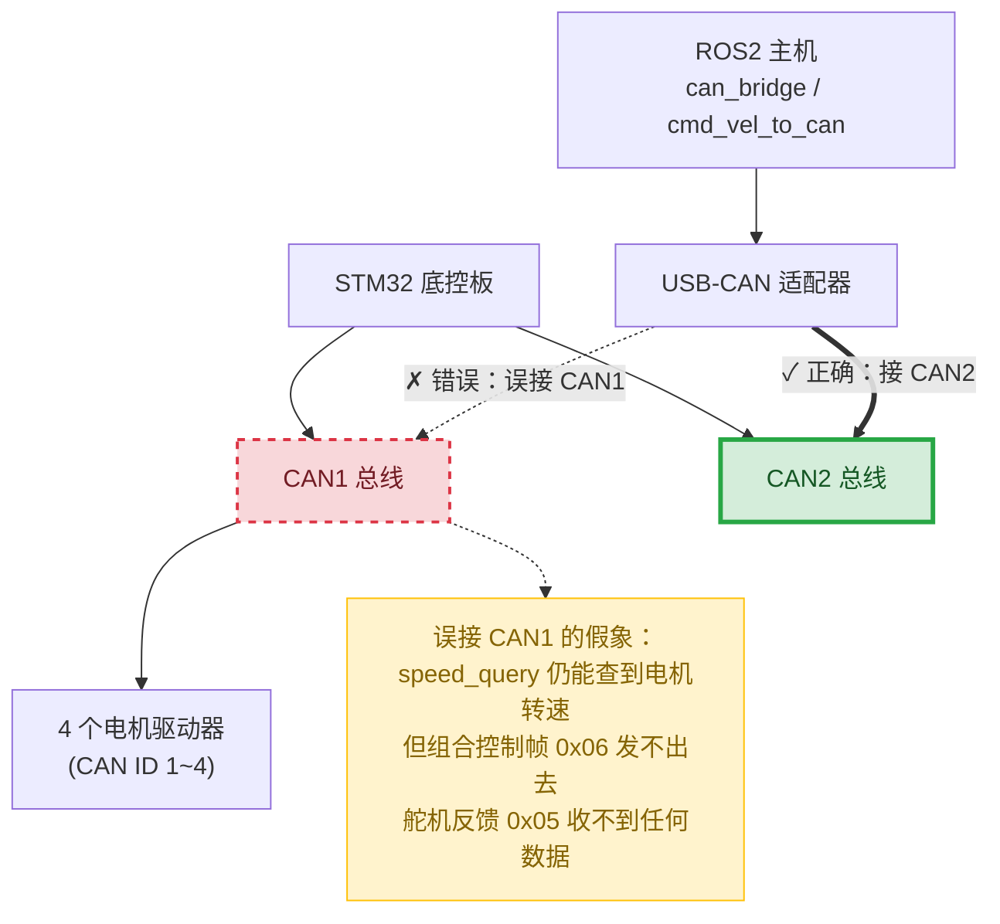
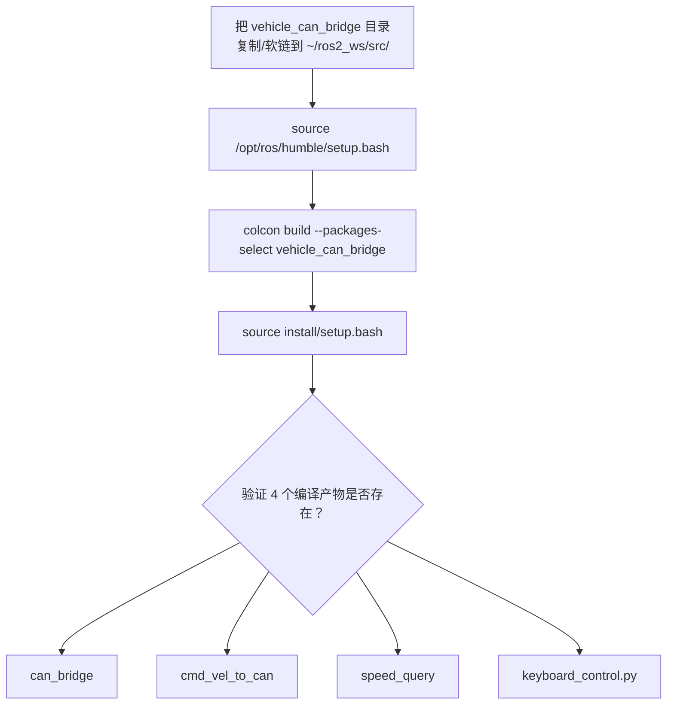
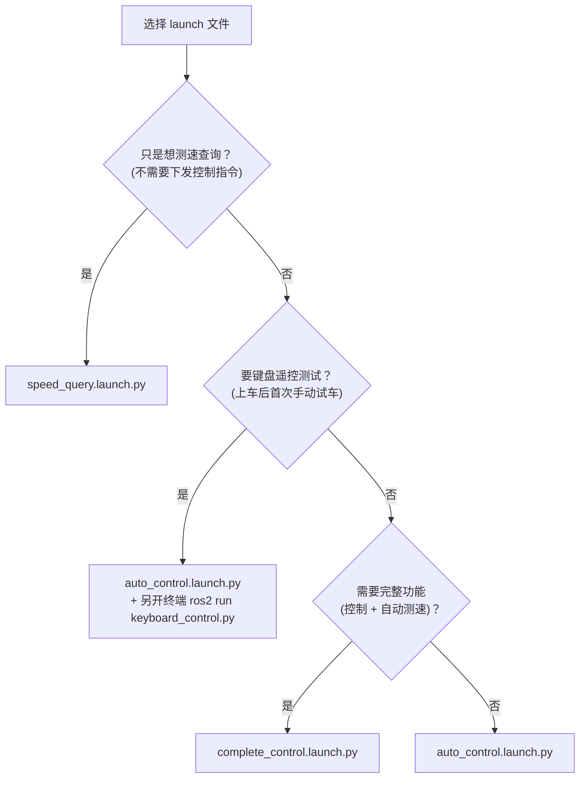
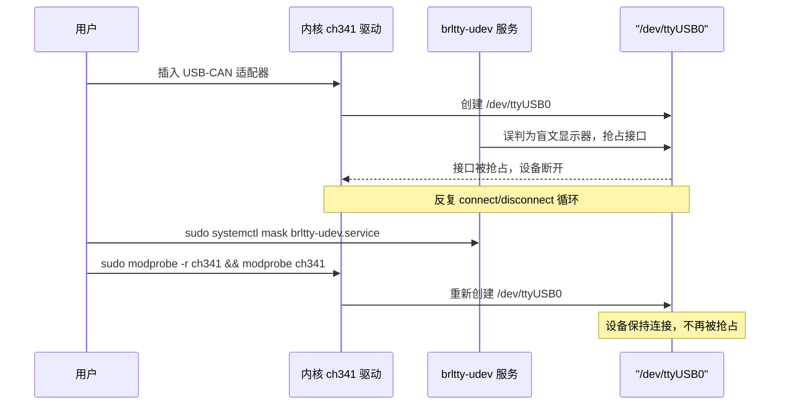

# vehicle_can_bridge 部署文档

本文档面向**在车载电脑上首次部署或重新部署** `vehicle_can_bridge` 这个 ROS2 包的人，聚焦"怎么把它正确装上车、连对硬件、跑起来"，不是操作教程（话题/参数的具体用法见另一份 getting-started 文档）。

`vehicle_can_bridge` 是 ROS1 同名包（`https://github.com/liuchongxiao/vehicle_can_bridge`）到 ROS2 (Humble) 的忠实移植：通过 USB-CAN 适配器 + 串口，把 AGV 底控 STM32 板接入 ROS2，让 ROS 侧控制车辆电机转速/转向，并读回传感器与状态反馈。移植设计的完整决策记录见 `docs/superpowers/specs/2026-07-11-vehicle-can-bridge-ros2-port-design.md`。

> 注意：`AGV_Navigation` 仓库本身用 ZMQ 而非 ROS 作为主通信架构，这个包是独立摆放的 ROS2 包，**不接入**仓库现有的 `agvs/`、`core/` 那套 `launch.py` 自动注册链路，只在需要 ROS2 生态（如 nav2/cartographer）的场景下单独部署使用。本仓库不是 git 仓库，本文档不涉及任何版本控制命令。

## 1. 目标环境要求

- **系统**：Ubuntu 22.04（或兼容版本）
- **ROS2 发行版**：Humble
- **外部 ROS2 包依赖**：无，除 `package.xml` 里声明的以下几项（均为 ROS2 Humble 标准安装自带，无需额外 `apt install ros-humble-xxx`）：
  - `rclcpp`、`std_msgs`、`geometry_msgs`（编译期）
  - `rosidl_default_generators`（编译期，生成消息）/ `rosidl_default_runtime`（运行期）
  - `rclpy`（运行期，`keyboard_control.py` 用）

**为什么没有外部依赖**：原 ROS1 包依赖两个 ROS1 生态专属的外部包——CAN 消息类型 `can_msgs::Frame`（来自 `ros_canopen`）和串口库 `serial`（`wjwwood/serial`）。这两者在 ROS2 里都没有官方保证可用的等价物，实测目标编译机上也未预装。为避免部署时依赖"环境里不一定存在"的外部包，移植时选择让本包自带：

- `msg/Frame.msg`：字段与原 `can_msgs/Frame` 完全一致（`header`/`id`/`is_rtr`/`is_extended`/`is_error`/`dlc`/`data[8]`），只是消息类型路径变成了 `vehicle_can_bridge/msg/Frame`。
- `include/vehicle_can_bridge/serial_port.hpp`：一个只覆盖本包实际用到的接口（`open`/`close`/`isOpen`/`write`/`read`/`available`/`flushInput`/`flushOutput`）的极简 POSIX termios 封装，零外部依赖，Ubuntu 上开箱即用。

结果是：只要有一个标准 ROS2 Humble 安装，`colcon build` 这个包不需要额外 `apt install` 任何 ROS 包。

## 2. 硬件前提

### 2.1 USB-CAN 适配器

本包对接的是**串口帧协议**的 USB-CAN 适配器（常见 CH340 芯片方案），不是 SocketCAN 设备，因此代码里直接读写 `/dev/ttyUSB*` 而不是 `can0` 之类的网络接口。串口帧格式简述：

```
0xAA + 控制字节(标准帧 0xC0|dlc / 扩展帧 0xE0|dlc) + CAN ID(小端2字节) + 数据(dlc字节) + 校验和 + 0x55
```

完整协议细节（组合控制帧格式、ERPM 换算公式、舵机角度分段映射、各 CAN ID 含义）见项目记忆 `reference_vehicle_can_bridge_ros.md`，此处不重复。

### 2.2 接线：必须接到 STM32 的 CAN2，不是 CAN1

**这是一条部署时最容易踩、但代码层面完全看不出来的坑**：STM32 底控板上有两条物理独立的 CAN 总线——**CAN1 接电机驱动器**，**CAN2 接 ROS 控制节点**。USB-CAN 适配器必须接到 **CAN2**。

如果误接到 CAN1：
- ROS 侧能查询/看到电机驱动器（`speed_query` 节点能收到 CAN ID 1~4 驱动器的转速响应），造成"CAN 链路是通的"的假象；
- 但 STM32 的控制通道会完全静默——组合控制帧（CAN ID `0x06`）发出去石沉大海，舵机角度反馈（CAN ID `0x05`）也收不到任何数据，`can_bridge` 节点看起来像是收不到任何反馈。

这个现象非常容易被误判为软件 bug（消息没发出去、话题没连上、CAN 帧编码错了），但实际上只是接线接错了总线。**部署时务必先用万用表/接线图确认适配器接的是 CAN2，再开始调试软件。**

下图直观展示正确接线（绿色实线）与误接 CAN1（红色虚线）的区别，以及误接后为什么会产生"看起来通了"的假象：



### 2.3 用户权限

运行节点的用户必须在 `dialout` 组里才能读写 `/dev/ttyUSB0`（串口设备默认属组是 `dialout`）。加组方法见第 7 节故障排查。

### 2.4 默认串口参数

- 设备路径默认 `/dev/ttyUSB0`
- 波特率默认 `2000000`（200 万）

两者都是 ROS2 参数（`port`、`baudrate`），可在 launch 文件里覆盖，不是写死的。如果车上适配器枚举出来不是 `ttyUSB0`（比如插了多个 USB 转串口设备），需要在对应 launch 文件里改 `port` 参数，或用 udev 规则固定设备名。

## 3. 编译步骤

整体流程如下（细节见下方命令）：



（这里的"4 个编译产物"指的是可执行文件/脚本本身，跟下面第 5 节的"3 个 launch 文件"是两回事——`keyboard_control.py` 一直是独立可执行的脚本，只是不再有对应的 launch 文件，见下文。）

标准 colcon workspace 布局：

```bash
mkdir -p ~/ros2_ws/src
cd ~/ros2_ws/src
# 把 AGV_Navigation/ros2/vehicle_can_bridge/ 整个目录放进来（复制或软链均可）
cp -r /path/to/AGV_Navigation/ros2/vehicle_can_bridge ~/ros2_ws/src/

cd ~/ros2_ws
source /opt/ros/humble/setup.bash
colcon build --packages-select vehicle_can_bridge
```

编译完成后，每个新终端会话使用本包前都需要 source overlay：

```bash
source ~/ros2_ws/install/setup.bash
```

（可以加进 `~/.bashrc`，但要注意如果同一台机器上还有其他 ROS2 workspace，source 顺序会影响哪个 overlay 生效。）

## 4. 验证编译产物

编译成功后，`install/vehicle_can_bridge/lib/vehicle_can_bridge/` 目录下应该有 **3 个 C++ 可执行文件 + 1 个 Python 脚本**：

```bash
ls ~/ros2_ws/install/vehicle_can_bridge/lib/vehicle_can_bridge/
```

应看到：

- `can_bridge` —— CAN 收发桥接节点（读写串口、解析/编码 CAN 帧、发布 `/can_rx`、订阅 `/can_tx`）
- `cmd_vel_to_can` —— `/cmd_vel` → CAN 组合控制帧转换节点
- `speed_query` —— 轮询 4 个驱动器转速的节点
- `keyboard_control.py` —— 键盘遥控测试脚本（发布 `/cmd_vel`）

任何一个缺失都说明编译没有完全成功，检查 `colcon build` 输出里对应目标的报错。

另外可以用 launch 文件语法检查确认 3 个 launch 文件本身没写错（不需要真的接硬件）：

```bash
ros2 launch vehicle_can_bridge auto_control.launch.py --show-args
ros2 launch vehicle_can_bridge complete_control.launch.py --show-args
ros2 launch vehicle_can_bridge speed_query.launch.py --show-args
```

`keyboard_control.py` 不是 launch 目标，没有 `--show-args` 可查；确认它编译产出正常，直接看第 4 节里 `ls` 的结果即可。

## 5. 部署时如何选 launch 文件

包里有 3 个 launch 文件，对应不同的部署场景（具体话题/参数用法见 getting-started 文档，这里只给选型建议）：



| launch 文件 | 拉起的节点 | 什么时候用 |
|---|---|---|
| `complete_control.launch.py` | `can_bridge`（含自动测速查询、舵机角度参数）+ `cmd_vel_to_can` | **正式部署首选**。既有控制通道也有测速轮询（`auto_query_enabled: true`，`query_frequency: 10.0`），是功能最完整的组合。 |
| `auto_control.launch.py` | `cmd_vel_to_can` + `can_bridge`（`enable_debug: true`，不开自动测速） | 只需要基本控制、不关心驱动器转速反馈时用。**不包含键盘遥控节点**——想要键盘遥控测试，起完这个 launch 后再另开一个终端 `ros2 run vehicle_can_bridge keyboard_control.py`（详见 GETTING_STARTED.md）。**注意**：这个 launch 里 `cmd_vel_to_can_node` 的 `wheel_radius` 是 `0.05`，与另外两个 launch 用的 `0.1275` 不一致——这是原 ROS1 包自身遗留的差异，移植时原样保留，不是本次移植引入的 bug，部署前需确认这个值是否符合实车轮径。 |
| `speed_query.launch.py` | 仅 `speed_query` | 只需要读驱动器转速、不需要下发控制指令的场景（比如诊断/测速专用机、不想让 ROS 侧有能力控制车辆时）。 |

`keyboard_control.py` 没有对应的 launch 文件，也不可能有——它只能用 `ros2 run` 单独起（`ros2 launch` 不给子进程分配真实 TTY，而这个脚本靠 `termios.tcgetattr(sys.stdin)` 读键盘输入，脱离真实 TTY 会立刻崩溃，2026-07-13 实测确认）。需要键盘遥控时，先用 `auto_control.launch.py` 或 `complete_control.launch.py` 起好核心节点，再在另一个终端 `ros2 run vehicle_can_bridge keyboard_control.py --ros-args -p speed:=0.5 -p turn:=1.0`。

`config/vehicle_params.yaml` 是一份参考配置，**没有被任何 launch 文件通过 `<rosparam file=...>` 加载**（3 个 launch 文件都是逐参数字面量赋值），部署时不要假设改这个文件会生效——要改参数就直接改对应 launch 文件里的 `parameters=[{...}]`。

## 6. 重新部署 / 更新

代码改动后重新编译：

```bash
cd ~/ros2_ws
source /opt/ros/humble/setup.bash
colcon build --packages-select vehicle_can_bridge
source install/setup.bash
```

一般**不需要 clean build**——增量编译对这个包足够用。以下情况建议清掉 `build/`、`install/` 里本包相关目录后重新全量编译：

- 改动了 `msg/Frame.msg`（消息接口变更，偶尔会有生成产物没有正确重新生成的情况）
- `CMakeLists.txt`/`package.xml` 结构性改动（新增/删除可执行文件、改依赖）后编译报出奇怪的、和改动对不上的错误

清理命令（只清本包，不影响 workspace 里其它包）：

```bash
rm -rf ~/ros2_ws/build/vehicle_can_bridge ~/ros2_ws/install/vehicle_can_bridge
cd ~/ros2_ws && colcon build --packages-select vehicle_can_bridge
```

## 7. 故障排查

### 7.1 接了线但控制通道完全没反应（能测到驱动器速度，但 `/vehicle/servo_angle` 无数据）

见 2.2 节——先怀疑 USB-CAN 适配器接到了 CAN1 而不是 CAN2。这是外观上最像软件 bug 的硬件问题，排查顺序建议：

1. 确认适配器物理接线在 STM32 板的 CAN2 端口
2. 确认后再检查 `can_bridge` 的 `enable_debug: true` 日志里是否有 CAN ID `0x05`（舵机反馈）的帧进来
3. 确认 `cmd_vel_to_can` 有没有把 CAN ID `0x06`（组合控制）发到 `/can_tx`（`ros2 topic echo /can_tx`）

### 7.2 `/dev/ttyUSB0` 反复出现又消失（connect/disconnect 循环）

**真实遇到过的坑**：部分 Ubuntu 桌面版预装了无障碍服务 `brltty`（盲文显示器驱动），它的 udev 规则会抢占常见 USB 转串口芯片（包括 CH340，USB ID `1a86:7523`），以为是盲文显示器插入。典型症状（`dmesg`/`journalctl` 里）：

```
ch341-uart converter now attached to ttyUSB0
usbfs: interface 0 claimed by ch341 while 'brltty' sets config #1
ch341-uart converter now disconnected from ttyUSB0
```

设备被 `brltty` 抢占后立刻又释放，串口反复闪现，`can_bridge` 节点连不上或连上就断。下图梳理了故障循环与修复路径：



修复：

```bash
sudo systemctl mask brltty-udev.service   # 必须 mask，因为它是 udev 触发的，不是普通 disable 能拦住
```

然后重新插拔适配器，或者重新加载驱动使其生效：

```bash
sudo modprobe -r ch341 && sudo modprobe ch341
```

### 7.3 打开串口报 Permission denied

用户不在 `dialout` 组：

```bash
sudo usermod -aG dialout $USER
```

**加组后必须重新登录（注销/重启）或者在当前终端执行 `newgrp dialout` 才会生效**——只是 `usermod` 完不重新登录，当前 shell 的组身份不会刷新，还是会报同样的权限错误。

### 7.4 编译产物缺失可执行文件

见第 4 节，逐个核对 `can_bridge`/`cmd_vel_to_can`/`speed_query`/`keyboard_control.py` 是否都在 `install/vehicle_can_bridge/lib/vehicle_can_bridge/` 下，缺哪个就去看 `colcon build` 对应目标的报错。

## 8. 安全提示

**这个包能直接控制真实车辆运动，部署即意味着车辆有被 ROS 指令控制的能力。** 具体行为：

- STM32 一旦在组合控制 CAN 通道（ID `0x06`）上收到任意一条消息，**如果此时 RC 遥控器的模式切换通道恰好处于"自动"位置**，STM32 就会从手动（RC 遥控）切到自动（ROS 指令）控制模式——也就是说，只要 `cmd_vel_to_can` 节点启动并开始发送（哪怕是零速度指令），配合 RC 遥控器处于自动挡，车辆控制权就已经交给 ROS 侧了。
- STM32 端有 **500ms 消息超时看门狗**：如果 ROS 侧停止发送控制帧超过 500ms，STM32 会自动退回手动（RC）控制模式。这是一个安全兜底，但不能替代人工确认——部署/联调时应始终有人手持 RC 遥控器、随时准备接管，且确认 RC 模式切换通道的当前位置，不要在不确定 RC 挡位的情况下启动 `cmd_vel_to_can`/`complete_control.launch.py`/`auto_control.launch.py`。
- 首次上车联调建议顺序：先只起 `speed_query.launch.py`（只读，无法控制车辆）确认 CAN 链路通；再起 `auto_control.launch.py`（`can_bridge` 不自动查询），另开终端 `ros2 run vehicle_can_bridge keyboard_control.py` 在低速环境下验证控制通道；最后再上 `complete_control.launch.py` 做完整功能验证。
