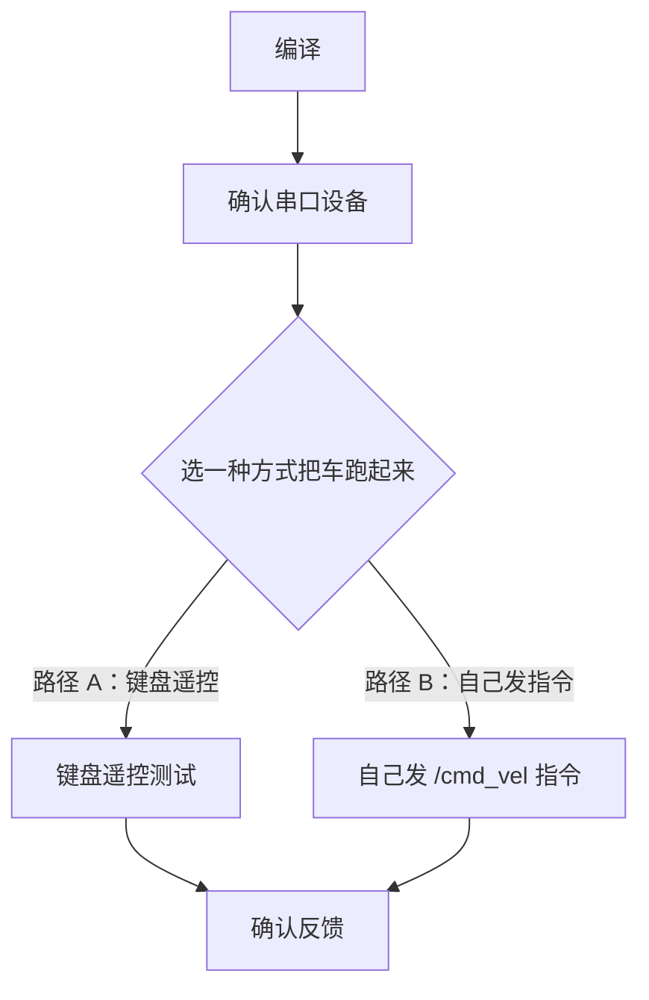
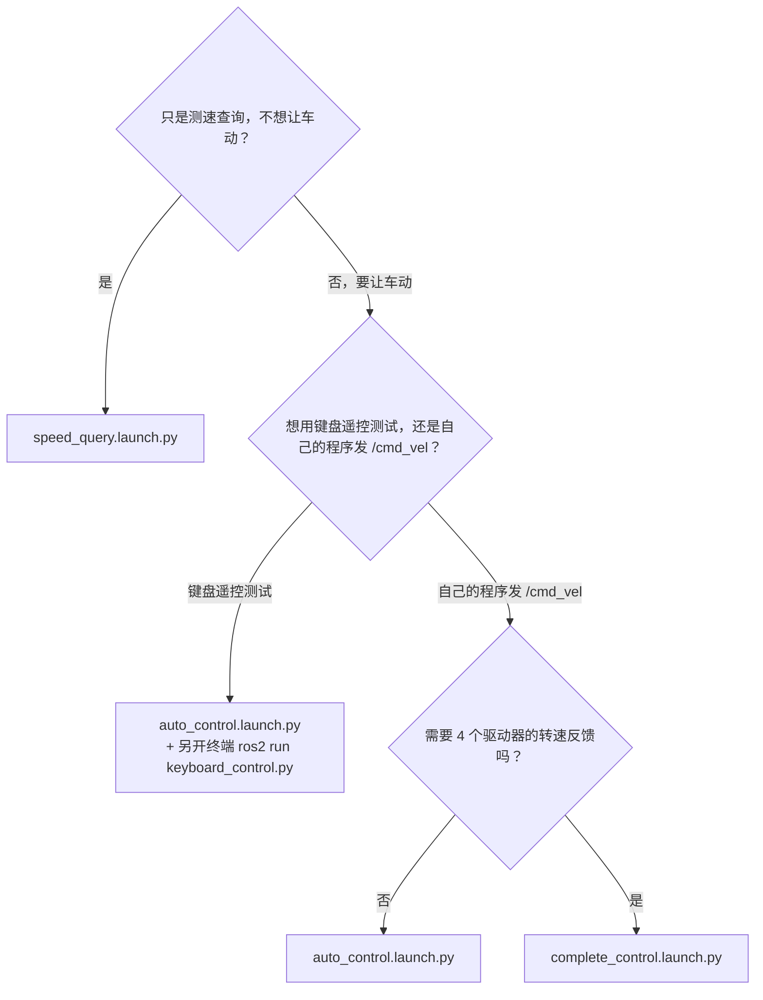

# vehicle_can_bridge 使用指南（快速上手）

本文是面向**使用者**的操作手册：只想让车动起来、验证控制链路是否打通，跟着下面的步骤走即可。

- 如果你要**从零部署这套系统到一台新机器**（装依赖、接线、排查串口/CAN 故障），请看 [DEPLOYMENT.md](./DEPLOYMENT.md)。
- 如果你想**看懂代码内部实现**（协议细节、节点间数据流），请看 [ARCHITECTURE.md](./ARCHITECTURE.md)。

---

## 前提条件

本文假设你已经具备以下条件：ROS2 Humble 已安装；USB-CAN 适配器已通过 CAN2 总线物理接到车辆的 STM32 底控板上并接好电；当前用户已加入 `dialout` 用户组（否则无法读写 `/dev/ttyUSB*` 串口设备）。如果这些条件还没满足，或者接线/依赖安装遇到问题，请先去看 [DEPLOYMENT.md](./DEPLOYMENT.md)，那里有完整的硬件接线图和依赖安装步骤。

### 整体流程一览

下面是本文接下来几步的全貌，后面每一节都是其中一个环节的详细展开：



---

## 第一步：编译

把包放进你的 colcon 工作区（本仓库不是 git 仓库，直接复制或软链目录即可，不需要 `git clone`）：

```bash
cd <你的colcon工作区>/src
# 把 ros2/vehicle_can_bridge/ 目录复制或软链进来，例如：
# cp -r /Users/kwhq/Documents/WorkSpace/AGV_Navigation/ros2/vehicle_can_bridge .
# 或者
# ln -s /Users/kwhq/Documents/WorkSpace/AGV_Navigation/ros2/vehicle_can_bridge .

cd <你的colcon工作区>
colcon build --packages-select vehicle_can_bridge
source install/setup.bash
```

> 注意：每开一个新终端窗口都要重新 `source install/setup.bash`（或者把它加进你的 `~/.bashrc`），否则 `ros2 launch`/`ros2 run` 会找不到这个包。

---

## 第二步：确认串口设备

USB-CAN 适配器插上电脑后，一般会枚举成 `/dev/ttyUSB0`。可以用下面的命令确认：

```bash
ls -l /dev/ttyUSB*
# 或者插拔适配器前后对比
dmesg | tail -20
```

如果确认设备号不是 `/dev/ttyUSB0`（比如插了多个 USB 转串口设备变成了 `/dev/ttyUSB1`），后面所有 launch 命令里的 `port` 参数都要对应改成实际设备路径。

如果设备完全不出现、或者插上后一闪而过又消失，**不要在这里排查** —— 直接看 [DEPLOYMENT.md](./DEPLOYMENT.md) 里的故障排查章节（里面有已知的 brltty 抢占串口等具体案例和解决办法）。

---

## 第三步：选一种方式把车跑起来

下面给两条路径，建议**先走路径 A** 确认链路通了、车能响应指令，再切换到路径 B 用自己的程序控制。

### 路径 A：键盘遥控（最快验证方式）

需要两个终端，分两步。

**第一步（终端 1）：拉起核心节点**

```bash
ros2 launch vehicle_can_bridge auto_control.launch.py
```

这条命令会拉起两个节点：

- `cmd_vel_to_can`（`cmd_vel_to_can_node`）：把 `/cmd_vel` 转换成 CAN 组合控制帧
- `can_bridge`（`can_bridge_node`）：把 CAN 帧通过串口发给 STM32，同时接收反馈

**第二步（终端 2）：另开一个终端，跑键盘遥控节点**

```bash
ros2 run vehicle_can_bridge keyboard_control.py --ros-args -p speed:=0.5 -p turn:=1.0
```

`-p speed:=0.5`（线速度，单位 m/s）、`-p turn:=1.0`（角速度，单位 rad/s）是原来 `auto_control.launch.py` 给这个节点设置的默认参数，需要显式传，不要依赖脚本自身硬编码的默认值（`speed=3.0`，明显偏快，不适合作为实际使用的默认值）。

从按键到车动起来，数据是这样流转的（简化示意，完整节点间协议细节见 [ARCHITECTURE.md](./ARCHITECTURE.md)）：


跑起来之后，**终端 2**（跑 `keyboard_control.py` 的那个）会变成键盘控制界面，需要保持这个终端窗口是焦点，按键才会被读到；终端 1 只是两个核心节点的日志输出，不需要聚焦它。按键说明如下（直接摘自 `keyboard_control.py`）：

| 按键 | 动作 |
|------|------|
| `w` | 前进 |
| `x` | 后退 |
| `s` | 停止 |
| `a` | 左转（原地转向，线速度为 0） |
| `d` | 右转（原地转向，线速度为 0） |
| `q` | 前进 + 左转 |
| `e` | 前进 + 右转 |
| `+` / `=` | 速度 +0.2 m/s |
| `-` / `_` | 速度 -0.2 m/s |
| `l` | 切换头灯/滚刷开/关（开关键，不是按住生效，发布到 `/vehicle/headlight_brush_cmd`） |
| `Ctrl-C` | 退出（退出时会自动发一帧全零的停止指令） |

跑起来之后可以用 `+`/`-` 现场调整线速度。

> 键盘遥控节点**只能用 `ros2 run` 启动，不能用 `ros2 launch`**：`ros2 launch` 不会给它管理的子进程分配真实的 TTY，而 `keyboard_control.py` 需要 `termios.tcgetattr(sys.stdin)` 读取原始按键输入，脱离真实 TTY 会在启动时立刻崩溃（`termios.error: (25, 'Inappropriate ioctl for device')`）。这是 2026-07-13 在真实硬件上验证过的结论，不是某个 launch 文件个别的问题。

### 路径 B：从自己的 ROS2 节点/程序发 `/cmd_vel` 指令

先拉起转换 + 桥接这两个节点（`auto_control.launch.py` 现在就只拉起这两个节点，不含键盘节点，直接用即可）：

```bash
ros2 launch vehicle_can_bridge auto_control.launch.py
# 如果还需要自动测速查询反馈（4个驱动器转速），改用：
# ros2 launch vehicle_can_bridge complete_control.launch.py
```

然后从命令行或自己的程序发布标准 `geometry_msgs/msg/Twist`：

```bash
ros2 topic pub /cmd_vel geometry_msgs/msg/Twist "{linear: {x: 0.3}, angular: {z: 0.0}}"
```

- `linear.x`：线速度，单位 m/s，正数前进、负数后退。
- `angular.z`：转向，单位 rad/s。**正数是左转，负数是右转**（`cmd_vel_to_can_node.cpp` 中 `angular_z > 0` 对应"左转"、映射到舵机角度 `[SERVO_LEFT_LIMIT, SERVO_CENTER_ANGLE]` 区间；`angular_z < 0` 对应"右转"，符合 ROS 标准右手坐标系约定）。

两个数值都会被节点参数 `max_linear_speed`（默认 2.0 m/s）和 `max_angular_speed`（默认 1.0 rad/s）夹住，超出会被裁剪并打印一条 WARN 日志。

---

## 第四步：确认车辆真的收到了指令 / 观察反馈

跑起来之后，可以另开终端订阅这几个话题，确认指令生效、车辆有反馈：

```bash
ros2 topic echo /vehicle/servo_angle       # 当前舵机角度反馈（0~180度，来自 STM32 CAN ID 0x05）
ros2 topic echo /vehicle/speed_response    # 4个驱动器的转速查询响应（需要 can_bridge 的自动测速查询开启，或单独跑 speed_query 节点）
ros2 topic echo /can_bridge_status         # can_bridge 节点自身状态（串口连接是否正常等）
```

如果 `/vehicle/servo_angle` 和 `/can_bridge_status` 有持续输出、且转动方向盘/发指令时角度值随之变化，说明链路已经打通。

---

## 3 个 launch 文件怎么选

| launch 文件 | 拉起的节点 | 用途 |
|---|---|---|
| `auto_control.launch.py` | `cmd_vel_to_can` + `can_bridge` | 最快验证链路是否通；键盘遥控测试时先起这个，再在第二个终端 `ros2 run` 键盘节点 |
| `complete_control.launch.py` | `can_bridge`（显式配置 10Hz 自动测速查询 + 转向标定参数）+ `cmd_vel_to_can` | 更完整的运行配置，适合用自己的程序发 `/cmd_vel` 并同时要转速反馈的场景 |
| `speed_query.launch.py` | `speed_query_node`（独立开串口，轮询 4 个驱动器转速） | 只测速查询、不发控制指令，不会让车动 |

键盘遥控节点（`keyboard_control.py`）不属于任何 launch 文件，**永远只用 `ros2 run` 起**（原因见上面路径 A 里的说明），跟 `auto_control.launch.py`/`complete_control.launch.py` 配合使用即可。

对应的选择逻辑画成流程图是这样（跟上表逻辑一致，只是换个角度方便快速判断）：



---

## 安全提示

车辆一旦收到 ROS 发来的控制指令，如果遥控器当时处于自动挡位，可能会切换到 ROS 控制模式并立即响应。**测试前务必确保车辆周围空间安全**，第一次测试建议把车架空（轮胎离地）或限制在很小的空间内进行，确认转向和前进/后退方向符合预期后再放到地面正常测试。

---

## 遇到问题怎么办

| 问题类型 | 去哪看 |
|---|---|
| 编译报错 / 找不到串口设备 / 硬件接线不通 / 依赖没装好 | [DEPLOYMENT.md](./DEPLOYMENT.md) |
| 想改代码 / 想搞懂 CAN 协议细节和节点内部实现 | [ARCHITECTURE.md](./ARCHITECTURE.md) |
